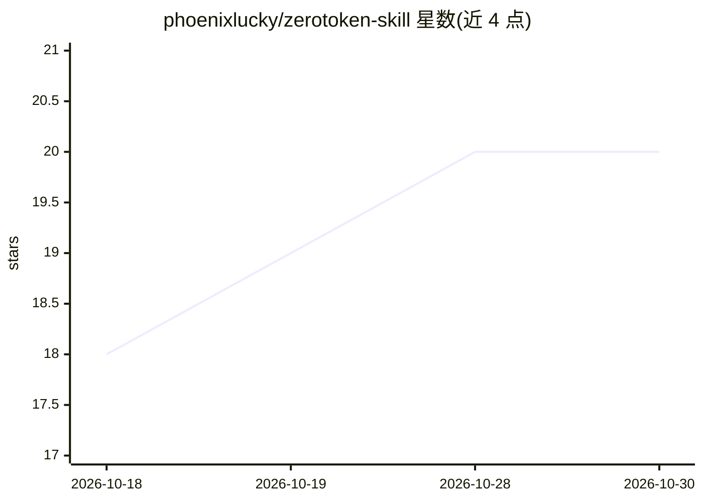

# phoenixlucky/zerotoken-skill

⭐ 20 · Python · GPL-3.0 · 推送 2026-10-16 · [GitHub](https://github.com/phoenixlucky/zerotoken-skill) · [官网](https://clawhub.ai/phoenixlucky/zerotoken-skill) · 个人维护 · 中文 README

**给 AI Agent 的省 token 提示词纪律规范技能包**

一套以 SKILL.md 为入口的提示词纪律规范：按请求特征自动匹配七种任务模式（问答/小改/多文件/总结/架构调整/Windows/POSIX），每种模式限定工具链、输出格式与 token 预算策略，并通过尉缭子十原则、八条核心原则约束权限边界与停止条件。附 references 参考文档与 scripts 工具集（环境检测、安全读写、编码审计等）。通过 AI 助手指令、install-source 或手动克隆载入，支持 Reasonix / Codex CLI / OpenCode / Hermes / Cline 等宿主。

## 筛选速览

| 维度 | 判定 | 备注 |
|---|---|---|
| AI 角色 | `ai-ecosystem` | LLM/agent 周边工具 |
| 许可风险 | `viral` | GPL-3.0 |
| 部署形态 | `None` |  |
| 模型依赖 | — | README 未给出锁定关系 |
| 硬件要求 | — | 无带数字的原话,不猜 |
| 安装摩擦 | `low` | 无编译、无系统依赖或容器化 |
| 成熟度 | — | 结构信号不足 |

## 能力要点

- 七种任务模式决策表，每模式限定工具链与 token 预算
- SKILL.md 常驻核心 ≤14KB，细节文档按需读取的分层结构
- 尉缭子十原则与 8 条核心原则约束行为边界
- 跨宿主工具链映射与 OpenAI 兼容预设（agents/openai.yaml）

## 适用场景

- 降低 Agent 对话中过度读取、过度思考、过度输出的 token 消耗
- 为 Codex/OpenCode/Cline 等编程 Agent 加载统一行为纪律
- Windows/PowerShell 环境下规避中文写入与编码陷阱

## 场景标签

`提示工程` · 领域:Agent 开发

## 证据(README 行号)

> L14: > **ZeroToken Skill** 是一套为 AI Agent 设计的**提示词纪律规范**——在不降低回答准确性的前提下，压缩无效上下文、无效解释、无效工具调用和无效输出。
> L20: > ✅ **适用于：** Reasonix / Codex CLI / OpenCode / Hermes / Cline 等主流 Agent 工具。一次学习，全平台受益。
> L66: ## 💻 平台集成

## 星数曲线

2026-10-18 18 → 2026-10-30 20（+2）

---
*卡片 v1 · prompt 1.4 · 生成 2026-10-28 · 置信度 high · 依据 README sha `7e865639987b` · [字段定义](../../DATASET.md)*
