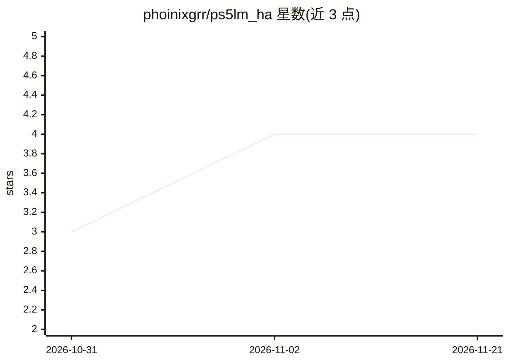

# phoinixgrr/ps5lm_ha

⭐ 4 · Python · AGPL-3.0 · 推送 2026-11-08 · [GitHub](https://github.com/phoinixgrr/ps5lm_ha) · 个人维护

**Home Assistant 集成：按需启停越狱 PS5 上的 llama.cpp 推理**

一个 Home Assistant 自定义集成，用于按需管理运行在越狱 PS5 GPU 上的 PS5LM（llama.cpp，提供 OpenAI 兼容 API）。通过 Remote Play 协议唤醒主机、登录用户、经 Payload Manager 启动应用，用完后送回待机模式。提供开关与服务供自动化调用，将模型指标（生成速度、token 计数、缓存命中率）与主机指标（温度、风扇、内存）暴露为传感器，支持模型下拉切换与 fleet worker 模式。要求越狱 PS5、chiaki-ng 注册等前提。

## 筛选速览

| 维度 | 判定 | 备注 |
|---|---|---|
| AI 角色 | `ai-ecosystem` | LLM/agent 周边工具 |
| 许可风险 | `viral` | AGPL-3.0 |
| 部署形态 | `None` |  |
| 模型依赖 | — | README 未给出锁定关系 |
| 硬件要求 | — | 无带数字的原话,不猜 |
| 安装摩擦 | `low` | 无编译、无系统依赖或容器化 |
| 成熟度 | — | 结构信号不足 |

## 能力要点

- 按需唤醒 PS5、启动/停止 PS5LM，用毕送回待机模式
- 模型切换下拉与每模型参数 profile（app-args.txt 写入与重启）
- 模型与主机指标作为传感器暴露（速度、token、温度、风扇）
- fleet worker 模式：作为其他机器 llama.cpp 的 RPC worker

## 适用场景

- 在 Home Assistant 自动化中按需调用 PS5 上的本地模型
- 夜间简报自动化：唤醒主机提问后自动回到待机
- 通过过热保护与空闲检测自动化管理推理负载

## 场景标签

`推理引擎` `工作流自动化` · 领域:效率与自动化

## 证据(README 行号)

> L9: PS5LM runs llama.cpp on the GPU of a jailbroken PS5 and serves an OpenAI-compatible API (about 45 tok/s on Qwen 3.5 
> L21: - Everything is a switch or a service, so automations can do it
> L87: Services: `ps5_launcher.wake`, `ps5_launcher.standby`, `ps5_launcher.start_app`, `ps5_launcher.stop_app`.

## 星数曲线

2026-10-31 3 → 2026-11-21 4（+1）

---
*卡片 v1 · prompt 1.4 · 生成 2026-11-21 · 置信度 high · 依据 README sha `623a7999cbb9` · [字段定义](../../DATASET.md)*
