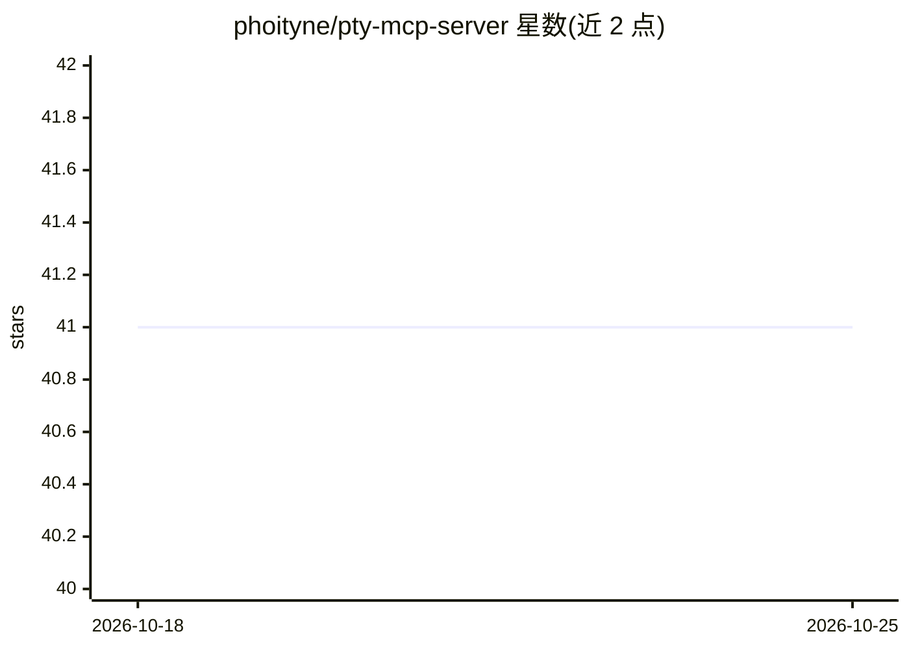

# phoityne/pty-mcp-server

⭐ 41 · Haskell · Apache-2.0 · 推送 2026-07-13 · [GitHub](https://github.com/phoityne/pty-mcp-server) · [官网](https://hackage.haskell.org/package/pty-mcp-server) · 个人维护

**让 AI agent 控制 PTY/进程/文件系统/套接字/串口的 MCP 服务器**

用 Haskell 实现的 MCP 服务器，通过 stdio 与 MCP 客户端通信，为 AI agent 提供伪终端会话及进程、文件系统、TCP/Unix 套接字、串口的直接 I/O 工具集：进程启动/读写/终止、文件读取/写入/正则搜索/打补丁、套接字与串口读写（UTF-8 与十六进制字节）、TCP 服务端监听与事件队列。面向需要终端交互或状态保持的 DevOps、IaC、REPL 自动化与遗留系统运维场景。README 开头附有人类监督警示；多个旧版 socket/serial 工具标记为 Deprecated，由 agent-* 系列替代。

## 筛选速览

| 维度 | 判定 | 备注 |
|---|---|---|
| AI 角色 | `ai-ecosystem` | LLM/agent 周边工具 |
| 许可风险 | `permissive` | Apache-2.0 |
| 部署形态 | `desktop` | 安装包/桌面程序 |
| 模型依赖 | — | README 未给出锁定关系 |
| 硬件要求 | — | 无带数字的原话,不猜 |
| 安装摩擦 | `low` | 无编译、无系统依赖或容器化 |
| 成熟度 | — | 结构信号不足 |

## 能力要点

- agent-proc / agent-socket / agent-server / agent-serial 四组进程与网络 I/O 工具
- pms-* 文件工具：部分行读取、POSIX ERE 搜索、unified diff 打补丁
- 仅通过 stdio 与 MCP 客户端通信
- 旧版 socket-*/serial-* 工具已标记 Deprecated，由 agent-* 替代

## 适用场景

- 让 agent 驱动 GHCi 等 REPL 或需要 PTY 的交互式 CLI
- 通过串口/控制台配置网络设备或嵌入式系统
- 执行含提示与状态交互的 Terraform/Ansible 等 IaC 工作流
- 仅支持终端交互的遗留系统自动化

## 场景标签

 · 领域:AI Agent 工具/系统运维

## 证据(README 行号)

> L16: **`pty-mcp-server`** is a Haskell implementation of an **MCP (Model Context Protocol) server** that enables AI agen
> L18: The server communicates exclusively via **standard input/output (stdio)**, ensuring simple and secure integration w

## 星数曲线

2026-10-18 41 → 2026-10-25 41（+0）

---
*卡片 v1 · prompt 1.4 · 生成 2026-10-25 · 置信度 high · 依据 README sha `addd6bb5f6fe` · [字段定义](../../DATASET.md)*
