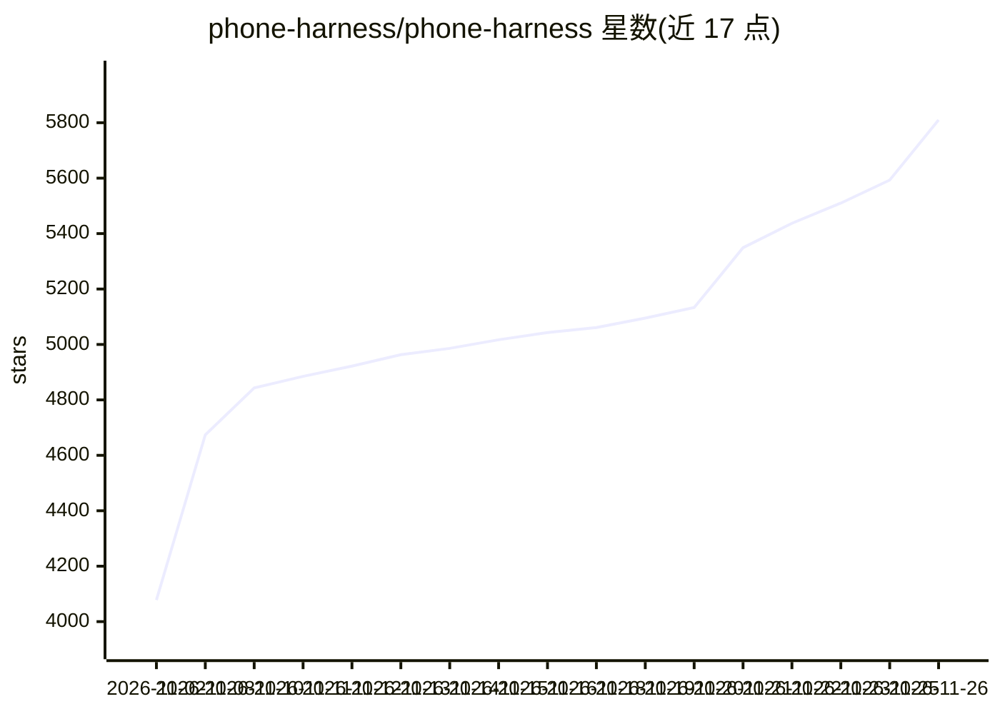

# phone-harness/phone-harness

⭐ 5,810 · Python · MIT · 推送 2026-11-24 · [GitHub](https://github.com/phone-harness/phone-harness) · [官网](phone-harness.com) · 组织维护

**让编码 agent 操控真实 iPhone/Android 的 CLI 工具**

phone-harness 提供 CLI、MCP 端点与插件，使 Claude Code、Codex 等 agent 能通过统一的 helper 函数（tap/type/find_text/screen 等）操控真实手机：iPhone 经 macOS iPhone Mirroring 窗口截图加 Vision OCR，Android 经 adb 与无障碍树读取，无需越狱或在手机上安装软件。另提供托管的 Phone Harness Cloud（按需 Android 与月租 iPhone，Stripe 押金预订）。依赖用户自行完成手机连接与权限授予。

## 筛选速览

| 维度 | 判定 | 备注 |
|---|---|---|
| AI 角色 | `ai-ecosystem` | LLM/agent 周边工具 |
| 许可风险 | `permissive` | MIT |
| 部署形态 | `None` |  |
| 模型依赖 | — | README 未给出锁定关系 |
| 硬件要求 | — | 无带数字的原话,不猜 |
| 安装摩擦 | `low` | 无编译、无系统依赖或容器化 |
| 成熟度 | — | 结构信号不足 |

## 能力要点

- iPhone/Android/云手机共用同一套 helper 接口，脚本可跨平台复用
- 支持 CLI 脚本、MCP 端点、Hermes 与 OpenClaw 插件多种接入方式
- iPhone 路径使用 Apple Vision OCR，Android 路径使用 adb 与无障碍树
- 配套 phone-harness doctor 检查安装与连接状态

## 适用场景

- 让编码 agent 代我在真机上完成点击、输入等操作
- 在云端 Android/iPhone 上自动化测试自己的应用
- 用脚本批量读取手机屏幕文本

## 场景标签

`GUI 自动化` · 领域:效率与自动化

## 证据(README 行号)

> L14: Enable Claude Code, Codex, or any agent to use your real phone. The agent can
> L60: **MCP:** add `https://mcp.phone-harness.com/mcp` to any MCP client (setup). Cloud Android and iPhone only for now.

## 星数曲线

2026-11-02 4,078 → 2026-11-26 5,810（+1,732）

---
*卡片 v1 · prompt 1.4 · 生成 2026-11-22 · 置信度 high · 依据 README sha `022b6847b376` · [字段定义](../../DATASET.md)*
