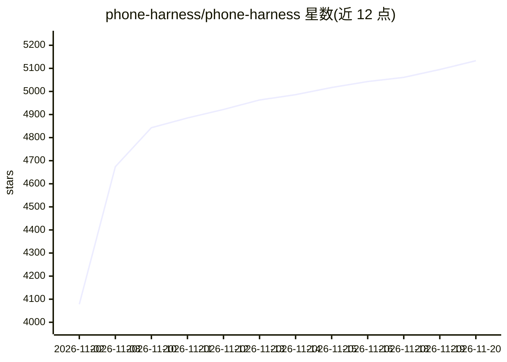

# phone-harness/phone-harness

⭐ 5,133 · Python · MIT · 推送 2026-11-09 · [GitHub](https://github.com/phone-harness/phone-harness) · [官网](phone-harness.com) · 组织维护

**让 AI agent 直接操控真机的 CLI 工具：滑动、点击、输入、读屏**

面向编码 agent（Claude Code、Codex 等）的手机操控工具集：通过统一 helpers 接口驱动 iPhone（Mac 的 iPhone Mirroring 窗口 + Apple Vision OCR）、Android（adb + 无障碍树）以及自家的云 Android/iPhone，无需越狱或手机端安装。提供 CLI（uv + Python 3.12 安装）、MCP 端点、Hermes/OpenClaw 插件集成及云端手机管理命令。限制：OCR 只识别文本不识别图标、不支持多点触控/摄像头/Face ID，解锁仍需用户操作。

## 筛选速览

| 维度 | 判定 | 备注 |
|---|---|---|
| AI 角色 | `ai-ecosystem` | LLM/agent 周边工具 |
| 许可风险 | `permissive` | MIT |
| 部署形态 | `None` |  |
| 模型依赖 | — | README 未给出锁定关系 |
| 硬件要求 | — | 无带数字的原话,不猜 |
| 安装摩擦 | `low` | 无编译、无系统依赖或容器化 |
| 成熟度 | — | 结构信号不足 |

## 能力要点

- iPhone 经 iPhone Mirroring 窗口 + Apple Vision OCR 读取并注入输入事件
- Android 经 adb 与无障碍树操控，支持 macOS/Linux/Windows
- 同一套 helpers 脚本可跨真机与云手机运行
- 提供 MCP 端点及 Hermes/OpenClaw 插件安装方式

## 适用场景

- 让 Claude Code/Codex 等 agent 在我的真机上执行点按、滑动、输入操作
- 用云 Android/iPhone 进行托管设备的自动化任务
- 编写跨平台手机操控脚本并交给 agent 执行

## 场景标签

`GUI 自动化` · 领域:效率与自动化

## 证据(README 行号)

> L14: Enable Claude Code, Codex, or any agent to use your real phone. The agent can
> L100: - **iPhone:** captures the iPhone Mirroring window, reads it with Apple's Vision OCR, and sends taps, swipes and t

## 星数曲线

2026-11-02 4,078 → 2026-11-20 5,133（+1,055）

---
*卡片 v1 · prompt 1.4 · 生成 2026-11-17 · 置信度 high · 依据 README sha `193df2638acf` · [字段定义](../../DATASET.md)*
