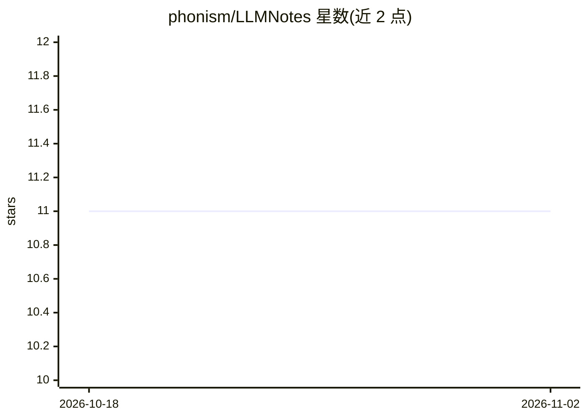

# phonism/LLMNotes

⭐ 11 · TeX · MIT · 推送 2026-02-28 · [GitHub](https://github.com/phonism/LLMNotes) · [官网](https://phonism.github.io/LLMNotes/) · 个人维护 · 中文 README

**LLM 与强化学习的中文学习笔记，含数学推导与 Slides**

以 LaTeX 撰写并发布为 Blog 的学习笔记，覆盖 Transformer/LLM（Tokenizer、RoPE、SwiGLU、FlashAttention、MLA、MoE、分布式训练、量化、KV Cache、投机解码等）与强化学习（DQN、PPO、MCTS、RLHF、DPO、GRPO 等）两大板块，含完整数学推导与评测设计内容。本地构建 PDF 依赖 XeLaTeX（TeX Live 2024+ / MacTeX），通过各目录下的 build.sh 生成。以 MIT 许可发布。

## 筛选速览

| 维度 | 判定 | 备注 |
|---|---|---|
| AI 角色 | `ai-knowledge` | 知识聚合/清单类 |
| 许可风险 | `permissive` | MIT |
| 部署形态 | `None` |  |
| 模型依赖 | — | README 未给出锁定关系 |
| 硬件要求 | — | 无带数字的原话,不猜 |
| 安装摩擦 | `low` | 无编译、无系统依赖或容器化 |
| 成熟度 | — | 结构信号不足 |

## 能力要点

- Transformer/LLM 八个 Part，覆盖架构组件、训练、评测与部署优化
- 强化学习六章，从 MDP/DQN 到 RLHF/DPO/GRPO/PRM 对齐
- 提供 XeLaTeX build.sh 构建 PDF 与在线 Blog

## 适用场景

- 系统学习 LLM 架构与训练推理优化的数学推导
- 学习 RLHF/DPO/PPO 等 LLM 对齐算法原理
- 作为面试或课程复习的结构化参考资料

## 场景标签

`教程课程` · 领域:学习与行业

## 证据(README 行号)

> L3: LLM 与强化学习学习笔记。
> L13: |I|基础理论|Roofline、计算分析、Scaling Law|

## 星数曲线

2026-10-18 11 → 2026-11-02 11（+0）

---
*卡片 v1 · prompt 1.4 · 生成 2026-11-01 · 置信度 high · 依据 README sha `d421b4dcf071` · [字段定义](../../DATASET.md)*
