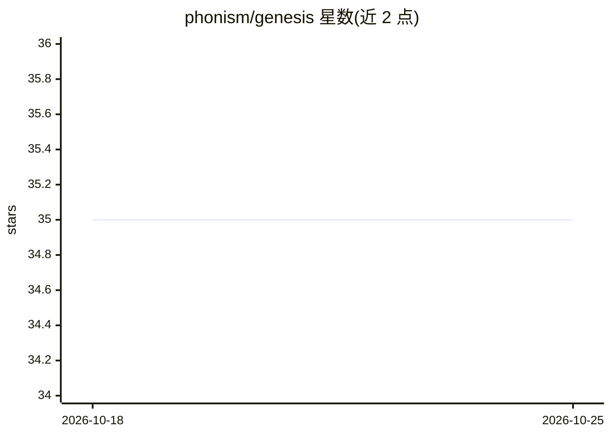

# phonism/genesis

⭐ 35 · Python · MIT · 推送 2026-01-15 · [GitHub](https://github.com/phonism/genesis) · [官网](https://phonism.github.io/genesis/) · 个人维护

**纯 Python 从零实现的深度学习框架，Triton 后端，兼顾教学与训练**

从零用 Python 编写的轻量深度学习框架，以 Triton 为 GPU 内核后端：提供自动微分（动态计算图）、完整神经网络模块库（含 transformer 与注意力）、混合精度训练（FP16/BF16 AMP）、基于 NCCL 的多 GPU 分布式训练，以及 Adam/AdamW/SGD 优化器套件。内置 Qwen LLM 实现与 SFT 训练、交互对话脚本。通过 git clone 源码安装，基准测试在 NVIDIA A100 上进行，定位为学习资源与实用训练框架。

## 筛选速览

| 维度 | 判定 | 备注 |
|---|---|---|
| AI 角色 | `ai-ecosystem` | LLM/agent 周边工具 |
| 许可风险 | `permissive` | MIT |
| 部署形态 | `library` | 以包/库形式分发 |
| 模型依赖 | — | README 未给出锁定关系 |
| 硬件要求 | — | 无带数字的原话,不猜 |
| 安装摩擦 | `medium` | 含编译或系统依赖之一 |
| 成熟度 | — | 结构信号不足 |

## 能力要点

- Triton 优化的 GPU 内核与自动微分动态计算图
- 混合精度（FP16/BF16 AMP）与 NCCL 多 GPU 分布式训练
- 内置 Qwen LLM 实现及 SFT 训练与对话脚本
- Adam/AdamW/SGD 优化器套件与 checkpoint 训练管线

## 适用场景

- 学习深度学习框架底层实现（autograd/内核/调度）
- 在多 GPU 环境训练模型或对 Qwen 做 SFT 微调
- 在自有代码中用 API 构建与训练神经网络

## 场景标签

`模型训练` `微调` `教程课程` · 领域:学习与行业

## 证据(README 行号)

> L15: Genesis is a modern deep learning framework built from scratch, combining **production-level performance** with **e
> L20: - 🔥 **High Performance**: Triton-optimized GPU kernels achieving near-native performance

## 星数曲线

2026-10-18 35 → 2026-10-25 35（+0）

---
*卡片 v1 · prompt 1.4 · 生成 2026-10-25 · 置信度 mid · 依据 README sha `22e9dd016d91` · [字段定义](../../DATASET.md)*
