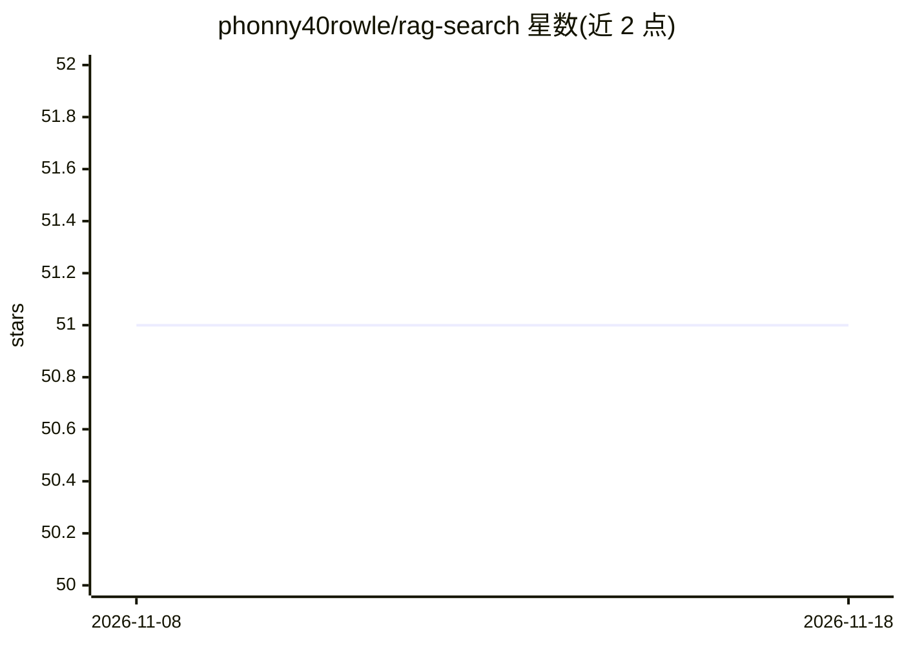

# phonny40rowle/rag-search

⭐ 51 · Python · Apache-2.0 · 推送 2026-11-05 · [GitHub](https://github.com/phonny40rowle/rag-search) · 个人维护

**自托管的 RAG 搜索 API：联网检索、抽取、嵌入与答案生成**

基于 FastAPI 的自托管检索增强搜索 API：通过配置的环境变量接入 Serper 网络搜索与 OpenAI 兼容端点，提供网页搜索、内容抽取、嵌入与答案生成，通过 HTTP API 请求消费结果。面向希望以服务形式部署 RAG 搜索能力的开发者；需自备 .env 配置（含搜索与 LLM 的 API key），以 pip 安装依赖并用 uvicorn 启动。README 内容简短，无更多机制细节。

## 筛选速览

| 维度 | 判定 | 备注 |
|---|---|---|
| AI 角色 | `ai-native` | 本体是模型或模型工具 |
| 许可风险 | `permissive` | Apache-2.0 |
| 部署形态 | `library` | 以包/库形式分发 |
| 模型依赖 | — | README 未给出锁定关系 |
| 硬件要求 | — | 无带数字的原话,不猜 |
| 安装摩擦 | `low` | 无编译、无系统依赖或容器化 |
| 成熟度 | — | 结构信号不足 |

## 能力要点

- 自托管 FastAPI 服务，提供 HTTP API
- 流程覆盖网络搜索、内容抽取、嵌入与答案生成
- 通过 .env 配置 Serper 搜索与 OpenAI 兼容端点

## 适用场景

- 自建带网络检索的问答/搜索 API 服务
- 将 RAG 搜索能力以接口形式接入自己的应用

## 场景标签

`RAG` · 领域:知识与检索

## 证据(README 行号)

> L1: # rag-search
> L3: A self-hosted RAG search API.

## 星数曲线

2026-11-08 51 → 2026-11-18 51（+0）

---
*卡片 v1 · prompt 1.4 · 生成 2026-11-18 · 置信度 low · 依据 README sha `95193f147708` · [字段定义](../../DATASET.md)*
