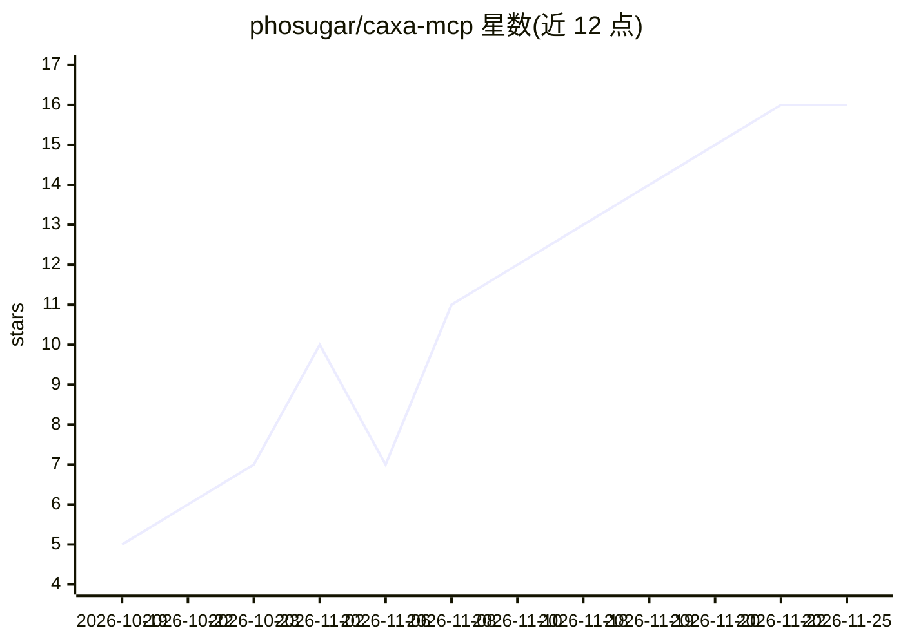

# phosugar/caxa-mcp

⭐ 16 · Python · MIT · 推送 2026-09-18 · [GitHub](https://github.com/phosugar/caxa-mcp) · 个人维护 · 中文 README

**让大模型驱动 CAXA CAD 自动绘制国标机械图纸的 MCP 服务端**

面向国产 CAD 软件 CAXA 电子图板的 Model Context Protocol 服务端，以 Python/FastMCP 实现，提供 10 个 MCP 工具：环境自检、启动 CAD、创建带 GB 标准图框与标题栏的图纸、批量绘制几何图元、尺寸标注、参数化零件生成（阶梯轴/法兰盘/底板）、打开 DXF/DWG、发送命令、视口截图与导出。图层线型遵循 GB/T 14665，图框标题栏遵循 GB/T 10609.1。面向使用 CAXA 的机械工程用户，通过 Claude Desktop、Gemini CLI、Cursor 等客户端以自然语言驱动出图；仅支持 Windows 与 CAXA 2023+。

## 筛选速览

| 维度 | 判定 | 备注 |
|---|---|---|
| AI 角色 | `ai-ecosystem` | LLM/agent 周边工具 |
| 许可风险 | `permissive` | MIT |
| 部署形态 | `desktop` | 安装包/桌面程序 |
| 模型依赖 | — | README 未给出锁定关系 |
| 硬件要求 | — | 无带数字的原话,不猜 |
| 安装摩擦 | `low` | 无编译、无系统依赖或容器化 |
| 成熟度 | `idea` | |

## 能力要点

- 10 个 MCP 工具覆盖启动、绘图、标注、参数化零件、截图与导出
- 图层/线型符合 GB/T 14665，图框标题栏符合 GB/T 10609.1
- 内置参数化零件：阶梯轴、法兰盘、带孔安装底板
- 自动定位 CAXA 2023 安装路径、窗口置顶并回传视口截图

## 适用场景

- 在 Claude Desktop 里用自然语言生成符合国标的机械零件图纸
- 批量生成带标准图框与标题栏的工程图
- 通过示例脚本自动绘制阶梯轴、法兰盘等参数化零件

## 场景标签

`代码生成` · 领域:编码与开发

## 证据(README 行号)

> L9:  全球首个面向国产工业 CAD 软件「数码大方 CAXA CAD 电子图板」的 Model Context Protocol (MCP) 服务端。
> L26: - **10 个工业级 MCP Tools**：包含环境自检、CAD 启动、图纸创建、几何原语绘制、智能尺寸标注、参数化零件生成、视口全屏缩放及无缝视口截图。
> L49:     -->|JSON-RPC via stdio| Server[CAXA FastMCP Server caxa_mcp/server.py]

## 星数曲线

2026-10-19 5 → 2026-11-25 16（+11）

---
*卡片 v1 · prompt 1.4 · 生成 2026-11-18 · 置信度 high · 依据 README sha `8ddcfdfa28ea` · [字段定义](../../DATASET.md)*
