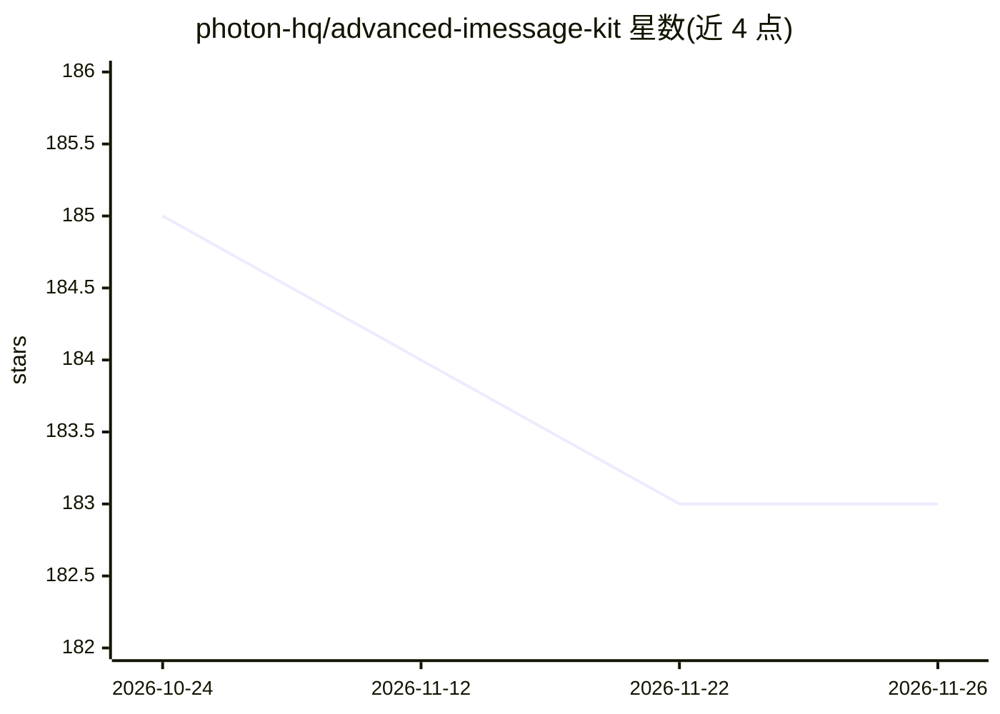

# photon-hq/advanced-imessage-kit

⭐ 183 · TypeScript · Apache-2.0 · 推送 2026-11-12 · [GitHub](https://github.com/photon-hq/advanced-imessage-kit) · [官网](https://photon.codes) · 组织维护

**面向开发者的 iMessage 自动化 TypeScript SDK**

连接本地或远程 iMessage 服务器的 TypeScript SDK：通过 messages/chats/contacts/polls/icloud 等模块提供发送与撤回消息、编辑消息、tapback 表情回应、定时消息、群聊管理、附件与贴纸发送、消息历史查询、实时事件监听与自动回复机器人构建等接口。支持 iMessage 与 SMS 两种服务类型及 chatGuid 自动检测。README 顶部声明仓库已不再维护，指引改用 Photon Spectrum（付费）或开源版 iMessage Kit。

## 筛选速览

| 维度 | 判定 | 备注 |
|---|---|---|
| AI 角色 | `ai-enhanced` | 去掉 AI 部分产品仍成立 |
| 许可风险 | `permissive` | Apache-2.0 |
| 部署形态 | `library` | 以包/库形式分发 |
| 模型依赖 | — | README 未给出锁定关系 |
| 硬件要求 | — | 无带数字的原话,不猜 |
| 安装摩擦 | `low` | 无编译、无系统依赖或容器化 |
| 成熟度 | `idea` | |

## 能力要点

- 消息全生命周期操作：发送、编辑、撤回、tapback、定时发送
- 支持文本特效、样式、动画与富链接预览
- 实时事件监听与自动回复机器人构建
- 支持群聊管理、投票、附件/贴纸/语音消息

## 适用场景

- 在 Mac 上构建 iMessage 自动回复机器人
- 定时批量发送 iMessage 或短信
- 通过脚本管理群聊、查询与归档消息历史

## 场景标签

`聊天机器人` · 领域:对话与助手

## 证据(README 行号)

> L71: npm install @photon-ai/advanced-imessage-kit
> L63: |Real-time Events|Listen for new messages, typing, etc.|`sdk.on()`|listen-simple.ts|

## 星数曲线

2026-10-24 185 → 2026-11-26 183（-2）

---
*卡片 v1 · prompt 1.4 · 生成 2026-11-26 · 置信度 mid · 依据 README sha `4e8d4e46f8ad` · [字段定义](../../DATASET.md)*
