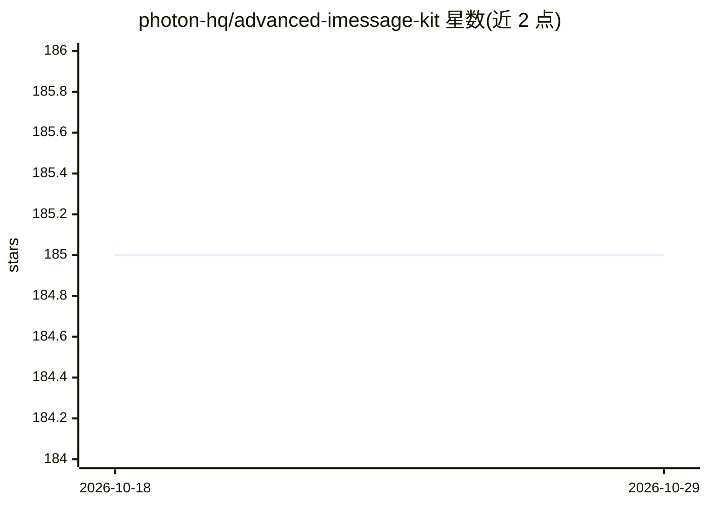

# photon-hq/advanced-imessage-kit

⭐ 185 · TypeScript · MIT · 推送 2026-06-08 · [GitHub](https://github.com/photon-hq/advanced-imessage-kit) · [官网](https://photon.codes) · 组织维护

**iMessage 自动化 TypeScript SDK（已停止维护）**

面向开发者的 TypeScript SDK，通过连接本地或远程 iMessage 服务器（默认 http://localhost:1234，支持 apiKey 鉴权）实现对 iMessage/SMS 的程序化操作：收发消息（含特效、富文本样式与逐字动画）、编辑/撤回/排期消息、Tapback 回应、附件与语音发送、群聊管理、投票、联系人查询、Find My 位置、实时事件监听与自动回复机器人等。README 顶部声明本仓库已弃用、不再维护，建议改用 Photon Spectrum（商业版）或免费开源版 iMessage Kit。

## 筛选速览

| 维度 | 判定 | 备注 |
|---|---|---|
| AI 角色 | `ai-enhanced` | 去掉 AI 部分产品仍成立 |
| 许可风险 | `permissive` | MIT |
| 部署形态 | `library` | 以包/库形式分发 |
| 模型依赖 | — | README 未给出锁定关系 |
| 硬件要求 | — | 无带数字的原话,不猜 |
| 安装摩擦 | `low` | 无编译、无系统依赖或容器化 |
| 成熟度 | — | 结构信号不足 |

## 能力要点

- 消息收发/编辑/撤回/排期/Tapback 全覆盖，含 13 种消息特效与文本样式动画
- 支持附件、语音、贴纸发送与群聊管理、投票、Find My 位置查询
- 实时事件监听（sdk.on()），可构建自动回复机器人
- 支持远程服务器模式：SDK 与 iMessage 服务器分机部署

## 适用场景

- 构建 iMessage 自动回复机器人
- 程序化批量收发、排期和管理 iMessage 消息
- 在服务器上集成 iMessage 收发与群聊管理能力

## 场景标签

 · 领域:即时通讯自动化/Apple 生态工具

## 证据(README 行号)

> L3: # Advanced iMessage Kit
> L64: |Auto Reply|Build automated reply bots|`sdk.on()`|auto-reply-hey.ts|

## 星数曲线

2026-10-18 185 → 2026-10-29 185（+0）

---
*卡片 v1 · prompt 1.4 · 生成 2026-10-22 · 置信度 mid · 依据 README sha `53ebd3b5bd1a` · [字段定义](../../DATASET.md)*
