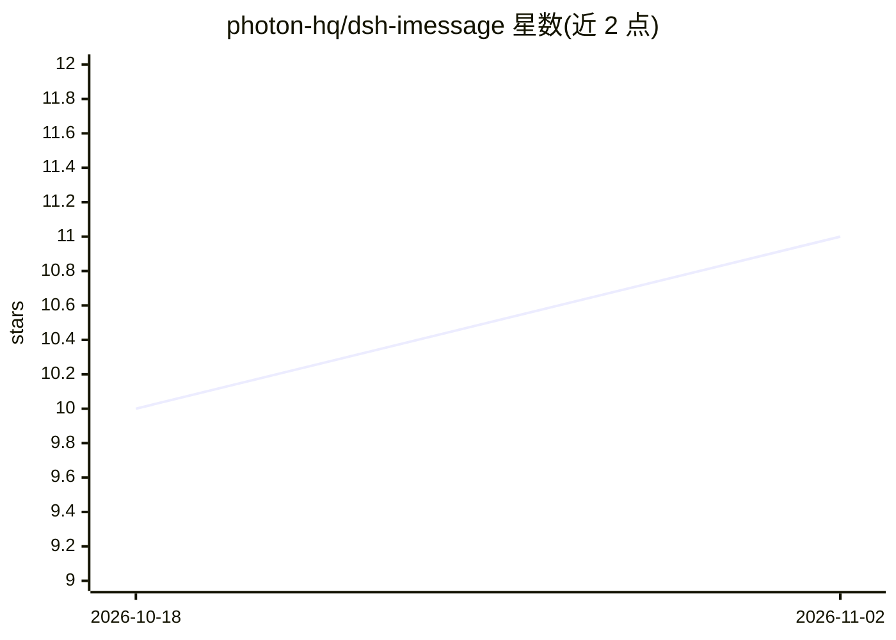

# photon-hq/dsh-imessage

⭐ 11 · TypeScript · MIT · 推送 2026-10-29 · [GitHub](https://github.com/photon-hq/dsh-imessage) · [官网](https://photon.codes) · 组织维护

**给 DeepSeek Harness 加 iMessage 通道的 Photon 托管插件**

dsh-imessage 是 DeepSeek Harness（DSH）的 web profile 插件：用户通过 Photon 设备登录授权、保存发送手机号并获得一个托管 iMessage 号码，来自该号码的短信即成为 DSH 提示词，DSH 的最终回答以纯文本回发。路由侧严格校验平台、方向、发送方 E.164 号码与专线归属，未授权流量不回复；不记录消息内容、令牌等敏感信息。提供会话管理、审批/问答转发等斜杠命令。v1 仅支持文本直聊，忽略附件、群聊、SMS 与 RCS；每个实例限一个 Photon 账号、一个发送号码与一条托管线路。

## 筛选速览

| 维度 | 判定 | 备注 |
|---|---|---|
| AI 角色 | `ai-ecosystem` | LLM/agent 周边工具 |
| 许可风险 | `permissive` | MIT |
| 部署形态 | `library` | 以包/库形式分发 |
| 模型依赖 | locked-api |  |
| 硬件要求 | — | 无带数字的原话,不猜 |
| 安装摩擦 | `low` | 无编译、无系统依赖或容器化 |
| 成熟度 | — | 结构信号不足 |

## 能力要点

- iMessage 入站消息作为 DSH 提示词，最终回答纯文本回发
- 基于 RFC 8628 设备流的 Photon 授权，令牌与设备码仅存于宿主
- 严格入站过滤：平台/方向/发送方 E.164/线路归属逐项校验，未授权流量静默忽略
- 会话切换、审批与问答（/approve、/deny、/answer）经 iMessage 操作，失败即闭环

## 适用场景

- 在手机 iMessage 里直接向 DSH agent 发提示词并收取回答
- 远程批准或拒绝 agent 的审批请求与提问
- 为 DSH 配置一条托管 iMessage 专线作为消息入口

## 场景标签

 · 领域:AI agent 消息接入/插件

## 证据(README 行号)

> L3: `dsh-imessage` adds a Photon-hosted iMessage transport and a **Settings → iMessage** page to the DeepSeek Harness we
> L16: dsh plugin --profile web add dsh-imessage

## 星数曲线

2026-10-18 10 → 2026-11-02 11（+1）

---
*卡片 v1 · prompt 1.4 · 生成 2026-11-02 · 置信度 high · 依据 README sha `1f5b234f166f` · [字段定义](../../DATASET.md)*
