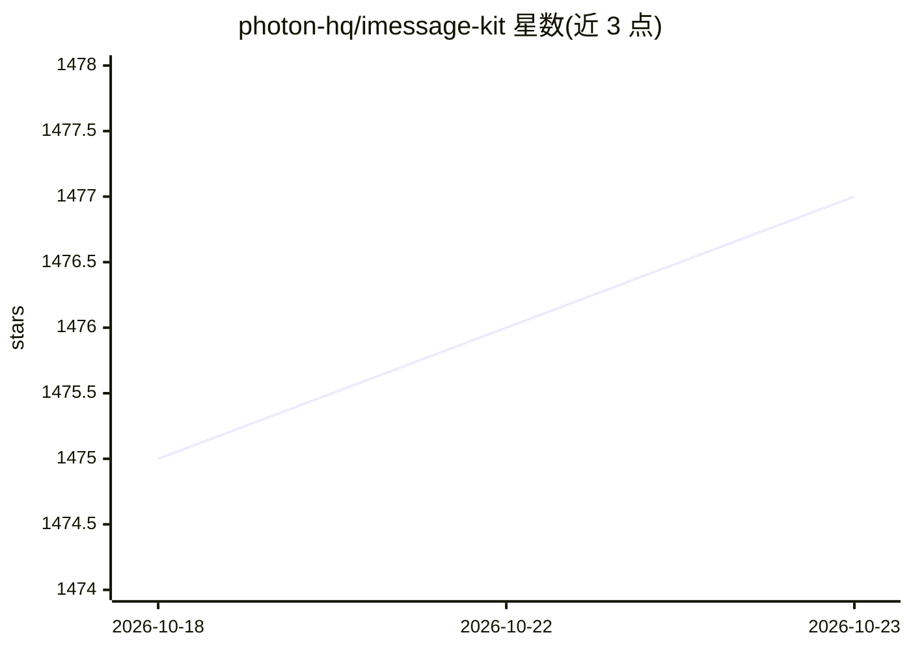

# photon-hq/imessage-kit

⭐ 1,477 · TypeScript · MIT · 推送 2026-06-08 · [GitHub](https://github.com/photon-hq/imessage-kit) · [官网](https://photon.codes) · 组织维护

**macOS 上的类型安全 iMessage SDK，供 AI agent 读写与自动回复消息**

面向开发者的 TypeScript iMessage SDK，运行于 macOS，读取 ~/Library/Messages/chat.db 查询历史消息与会话，通过 AppleScript/osascript 发送文本与附件，基于 WAL 实现实时消息监听（含自动回复场景），并提供 11 个钩子的插件系统。定位为构建 AI agent、自动化工具与聊天应用的通信基础设施，属 Photon 多渠道 agent 框架生态。限制：仅 macOS、需 Full Disk Access 权限、Node.js 下需 better-sqlite3、发送仅为 fire-and-forget 不确认入库。

## 筛选速览

| 维度 | 判定 | 备注 |
|---|---|---|
| AI 角色 | `ai-ecosystem` | LLM/agent 周边工具 |
| 许可风险 | `permissive` | MIT |
| 部署形态 | `library` | 以包/库形式分发 |
| 模型依赖 | — | README 未给出锁定关系 |
| 硬件要求 | — | 无带数字的原话,不猜 |
| 安装摩擦 | `low` | 无编译、无系统依赖或容器化 |
| 成熟度 | — | 结构信号不足 |

## 能力要点

- 读取 chat.db 查询消息/会话，AppleScript 派发发送文本与附件
- WAL 实时监听 5 类事件回调，支持自动回复模式
- 插件系统含 11 个钩子，onBeforeSend 可作鉴权/策略拦截
- Bun 运行时零依赖；提供 llms.txt 供语言模型使用

## 适用场景

- 构建通过 iMessage 收发消息的 AI agent
- 实现 iMessage 到达时的自动回复机器人
- 查询本机 iMessage 历史做分析或审计工具

## 场景标签

 · 领域:通信基础设施/开发库

## 证据(README 行号)

> L12: A full-featured iMessage SDK for **reading**, **sending**, and **automating** iMessage conversations on macOS. Perf
> L19: **Photon** builds infrastructure for AI agents that operate over real communication channels.

## 星数曲线

2026-10-18 1,475 → 2026-10-23 1,477（+2）

---
*卡片 v1 · prompt 1.4 · 生成 2026-10-21 · 置信度 high · 依据 README sha `d6c494719107` · [字段定义](../../DATASET.md)*
