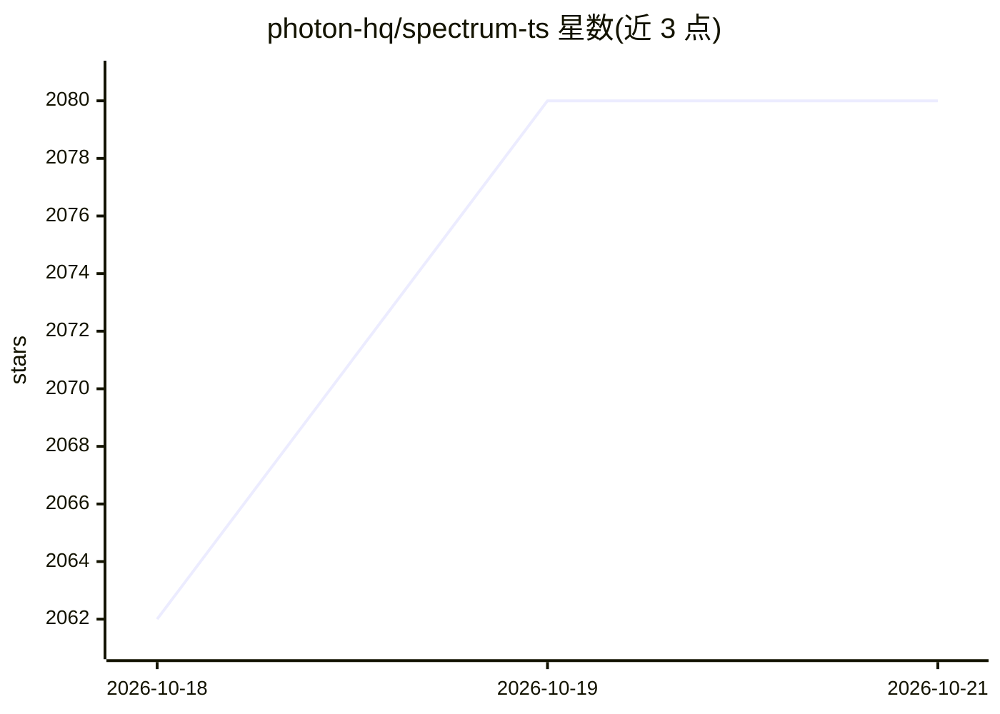

# photon-hq/spectrum-ts

⭐ 2,080 · TypeScript · MIT · 推送 2026-10-16 · [GitHub](https://github.com/photon-hq/spectrum-ts) · [官网](https://photon.codes/spectrum) · 组织维护

**多渠道 agent 框架：让 AI agent 运行在 iMessage/SMS 等真实通讯界面**

Photon 公司开源的多渠道 agent 框架（TypeScript，npm 包 spectrum-ts）：将 AI agent 接入 iMessage、WhatsApp Business、Telegram、Slack、终端等用户已有的通讯界面，而非仅限网页聊天。SDK 内含运行时与标准 provider 集合，也支持依赖 @spectrum-ts/core 按需精简安装；可完全独立运行，如通过 @spectrum-ts/imessage-local 连接本地 iMessage 数据库、自带 gRPC 端点或用 definePlatform 自建 provider。另提供 Spectrum Cloud 托管服务（app.photon.codes 注册获取项目 ID 与 secret）。

## 筛选速览

| 维度 | 判定 | 备注 |
|---|---|---|
| AI 角色 | `ai-ecosystem` | LLM/agent 周边工具 |
| 许可风险 | `permissive` | MIT |
| 部署形态 | `None` |  |
| 模型依赖 | — | README 未给出锁定关系 |
| 硬件要求 | — | 无带数字的原话,不猜 |
| 安装摩擦 | `low` | 无编译、无系统依赖或容器化 |
| 成熟度 | — | 结构信号不足 |

## 能力要点

- 接入 iMessage、WhatsApp Business、Telegram、Slack、终端等多平台
- SDK 内含运行时与标准 provider 集，也可按需精简安装
- 支持独立运行：本地 iMessage 数据库、自有 gRPC 端点、definePlatform 自建 provider

## 适用场景

- 把自己的 AI agent 部署到 iMessage/Telegram/Slack 等用户日常使用的渠道
- 构建跨多个通讯平台统一接入的 agent 服务
- 通过 Spectrum Cloud 快速获得 iMessage 等平台托管凭据

## 场景标签

`Agent 框架` · 领域:Agent 开发

## 证据(README 行号)

> L16: Spectrum is Photon’s open-source multi-channel agent framework, enabling AI agents to communicate through interface
> L14: **Photon** builds infrastructure for AI agents that operate over real communication channels.

## 星数曲线

2026-10-18 2,062 → 2026-10-21 2,080（+18）

---
*卡片 v1 · prompt 1.4 · 生成 2026-10-21 · 置信度 high · 依据 README sha `d62234bb7437` · [字段定义](../../DATASET.md)*
