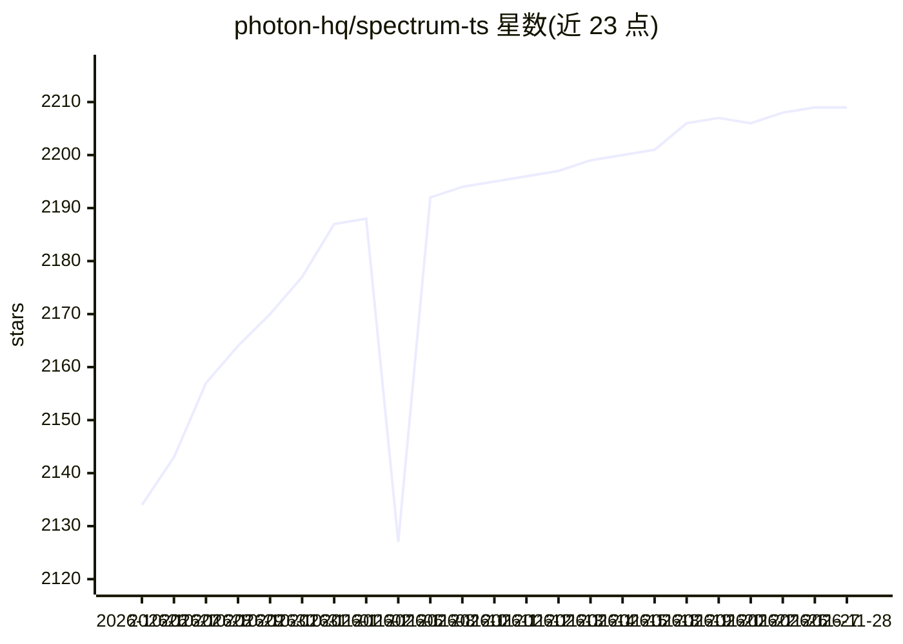

# photon-hq/spectrum-ts

⭐ 2,209 · TypeScript · Apache-2.0 · 推送 2026-11-26 · [GitHub](https://github.com/photon-hq/spectrum-ts) · [官网](https://photon.codes/spectrum) · 组织维护

**让 AI agent 通过 iMessage/SMS/邮件等真实渠道触达用户的 TypeScript 框架**

Spectrum 是 Photon 开源的多渠道 agent 框架，提供运行时与一组平台 provider，使 AI agent 可通过 iMessage、SMS、邮件、Slack、Discord、Telegram、语音等人们已有的通信界面收发消息，而非局限在网页聊天中。SDK 以 npm 包分发，`spectrum-ts` 为 batteries-included 安装（含标准 provider 集），也可按需只装 `@spectrum-ts/core` 与所用 provider。支持 Spectrum Cloud 托管基础设施，也可完全独立运行：连接本地 iMessage 数据库、自带 gRPC 端点或自建 provider。启动阶段支持 AbortSignal 取消及失败时的资源清理。许可证为 Apache-2.0。

## 筛选速览

| 维度 | 判定 | 备注 |
|---|---|---|
| AI 角色 | `ai-ecosystem` | LLM/agent 周边工具 |
| 许可风险 | `permissive` | Apache-2.0 |
| 部署形态 | `None` |  |
| 模型依赖 | — | README 未给出锁定关系 |
| 硬件要求 | — | 无带数字的原话,不猜 |
| 安装摩擦 | `low` | 无编译、无系统依赖或容器化 |
| 成熟度 | — | 结构信号不足 |

## 能力要点

- 多渠道接入：iMessage、SMS、email、Slack、Discord、Telegram、语音等
- batteries-included 安装或按 provider 拆分安装两种方式
- 支持 Spectrum Cloud 托管或完全自托管（本地 iMessage 数据库/自建 provider）
- 启动取消机制：AbortSignal 传递、失败清理与 SpectrumStartupCleanupError

## 适用场景

- 让 agent 通过 iMessage/SMS 与用户对话
- 在 Slack/Discord/Telegram 中接入同一个 agent
- 自托管连接本地 iMessage 数据库运行 agent

## 场景标签

`Agent 框架` · 领域:Agent 开发

## 证据(README 行号)

> L4:  Photon (photon.codes) builds Spectrum, a multi-channel agent framework that makes AI agents reachable over real con
> L16: Spectrum is Photon’s open-source multi-channel agent framework, enabling AI agents to communicate through interface
> L41: Spectrum also runs fully standalone — you can connect to a local iMessage database with the separate `@spectrum-ts/

## 星数曲线

2026-10-26 2,134 → 2026-11-28 2,209（+75）

---
*卡片 v1 · prompt 1.4 · 生成 2026-11-23 · 置信度 high · 依据 README sha `9f5e1ebf1055` · [字段定义](../../DATASET.md)*
