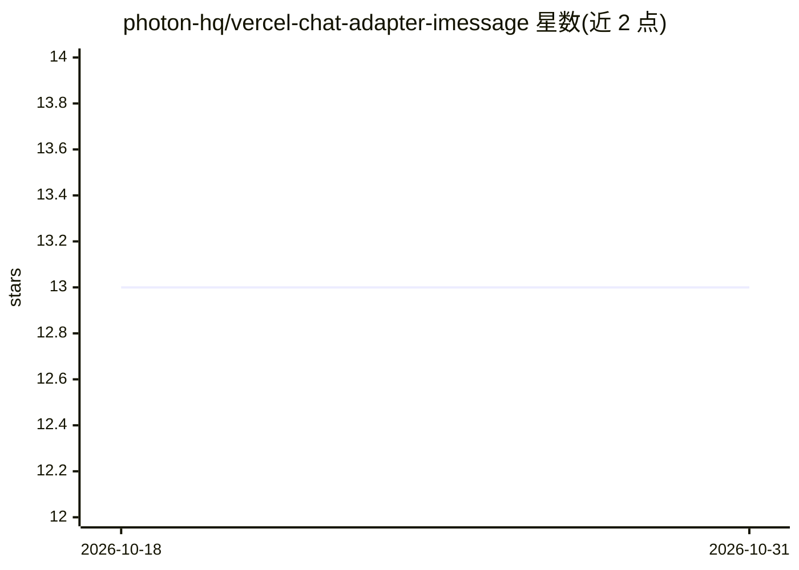

# photon-hq/vercel-chat-adapter-imessage

⭐ 13 · TypeScript · MIT · 推送 2026-07-27 · [GitHub](https://github.com/photon-hq/vercel-chat-adapter-imessage) · 组织维护

**Chat SDK 的 iMessage 适配器：让聊天机器人接入 iMessage**

基于 spectrum-ts 构建的 Chat SDK 社区适配器，面向在 iMessage 上部署聊天机器人的开发者。提供 Cloud（Spectrum Cloud，项目 ID+密钥）与自托管（连接 @photon-ai/advanced-imessage gRPC 端点）两种模式，环境变量自动检测。支持 DM、tapback 反应、消息编辑/撤回、动效、语音、mini-app 卡片、聊天背景等；入站消息经 Webhook 或 Gateway 监听接收。限制：不支持消息历史、流式回复与临时消息，Modals 仅映射为投票。

## 筛选速览

| 维度 | 判定 | 备注 |
|---|---|---|
| AI 角色 | `ai-ecosystem` | LLM/agent 周边工具 |
| 许可风险 | `permissive` | MIT |
| 部署形态 | `library` | 以包/库形式分发 |
| 模型依赖 | — | README 未给出锁定关系 |
| 硬件要求 | — | 无带数字的原话,不猜 |
| 安装摩擦 | `low` | 无编译、无系统依赖或容器化 |
| 成熟度 | — | 结构信号不足 |

## 能力要点

- Cloud 与自托管 gRPC 双模式，环境变量自动检测
- Webhook 签名验证（HMAC、拒绝超 5 分钟过期请求）与 Gateway 监听两种入站方式
- iMessage 特性支持：tapback、消息动效、mini-app 卡片、语音、聊天背景
- Modals 映射为 iMessage 原生投票（仅 Select，2-10 选项）

## 适用场景

- 在 iMessage 上部署客服或聊天机器人
- 通过 Vercel Cron 在 serverless 环境维持 Gateway 连接
- 向 iMessage 用户发送富卡片、投票与消息动效

## 场景标签

`聊天机器人` · 领域:对话与助手

## 证据(README 行号)

> L1: # @photon-ai/chat-adapter-imessage
> L3: iMessage community adapter for Chat SDK. Built on spectrum-ts, Photon's unified messaging SDK. Supports **cloud** (S

## 星数曲线

2026-10-18 13 → 2026-10-31 13（+0）

---
*卡片 v1 · prompt 1.4 · 生成 2026-10-31 · 置信度 high · 依据 README sha `2742d997f48c` · [字段定义](../../DATASET.md)*
