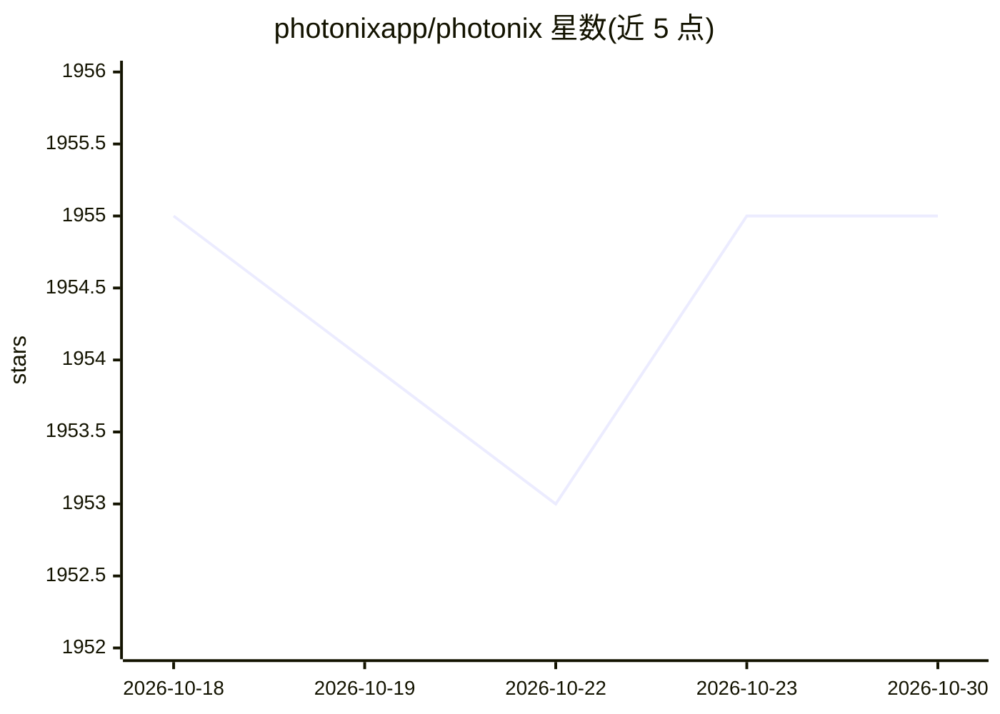

# photonixapp/photonix

⭐ 1,955 · Python · AGPL-3.0 · 推送 2026-10-28 · [GitHub](https://github.com/photonixapp/photonix) · [官网](https://photonix.org/) · 组织维护

**自托管照片管理服务器：用物体/人脸识别等智能过滤找照片**

基于 Web 技术的照片管理应用，运行在家庭服务器上，通过任意设备的浏览器访问照片库。智能过滤由物体识别、人脸识别、位置感知、颜色分析等 ML 算法自动完成。照片导入后自动检测；数据库、缩略图等缓存数据与照片目录分开存储。README 声明项目仍在开发中、尚未达到 1.0 功能完整，推荐以 Docker Compose 方式运行，超级用户与图库需通过命令行创建。

## 筛选速览

| 维度 | 判定 | 备注 |
|---|---|---|
| AI 角色 | `ai-enhanced` | 去掉 AI 部分产品仍成立 |
| 许可风险 | `viral` | AGPL-3.0 |
| 部署形态 | `self-host` | docker 或自建部署 |
| 模型依赖 | — | README 未给出锁定关系 |
| 硬件要求 | — | 无带数字的原话,不猜 |
| 安装摩擦 | `low` | 无编译、无系统依赖或容器化 |
| 成熟度 | `idea` | |

## 能力要点

- 物体识别、人脸识别、位置感知、颜色分析实现智能过滤
- 照片放入目录即被自动检测并导入
- 数据库/缩略图与照片目录分离存储
- 提供 Docker Compose 预构建镜像与开发用 Makefile 流程

## 适用场景

- 在家庭服务器上自建照片库，从任意设备浏览查找
- 按物体、人脸、地点、颜色等条件筛选照片
- 开发者克隆仓库参与贡献或本地调试

## 场景标签

`人脸识别` `目标检测` · 领域:感知与多模态

## 证据(README 行号)

> L5: This is a photo management application based on web technologies. Run it on your home server and it will let you fin
> L9: This project is currently in development and not feature complete for a version 1.0 yet. If you don't mind putting u

## 星数曲线

2026-10-18 1,955 → 2026-10-30 1,955（+0）

---
*卡片 v1 · prompt 1.4 · 生成 2026-10-21 · 置信度 high · 依据 README sha `9b81de9bc480` · [字段定义](../../DATASET.md)*
