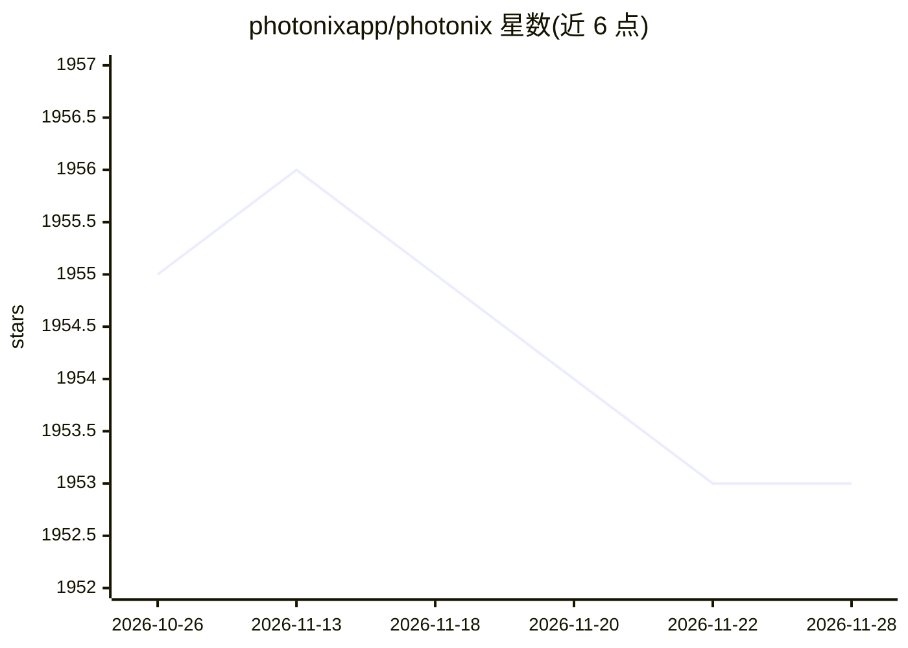

# photonixapp/photonix

⭐ 1,953 · Python · AGPL-3.0 · 推送 2026-11-24 · [GitHub](https://github.com/photonixapp/photonix) · [官网](https://photonix.org/) · 组织维护

**自托管照片管理服务器：用 ML 识别帮你在多设备找到照片**

基于 Web 技术的照片管理服务器，部署在家庭服务器上，可在任意设备浏览和检索照片库。分析流程提供物体识别、人脸识别、位置感知、色彩分析等自动分类能力，用于智能过滤。通过 Docker Compose 运行预构建镜像，照片放入监控目录即被检测导入。README 载明项目尚在开发、未达 1.0 功能完整度，并给出详细的内存占用测量数据：默认布局峰值超 6 GB，低内存布局需 4-5 GB，也可关闭分类器以 1 GB 运行。

## 筛选速览

| 维度 | 判定 | 备注 |
|---|---|---|
| AI 角色 | `ai-enhanced` | 去掉 AI 部分产品仍成立 |
| 许可风险 | `viral` | AGPL-3.0 |
| 部署形态 | `self-host` | docker 或自建部署 |
| 模型依赖 | — | README 未给出锁定关系 |
| 硬件要求 | — | 无带数字的原话,不猜 |
| 安装摩擦 | `low` | 无编译、无系统依赖或容器化 |
| 成熟度 | `idea` | |

## 能力要点

- 物体识别、人脸识别、位置感知、色彩分析的自动智能过滤
- Docker Compose 一键拉起，照片目录即时检测导入
- 提供实测的分级内存配置：1 GB（关分类器）到 6 GB+（全功能）
- LOW_MEMORY/CLASSIFICATION_DISABLED 等环境变量可精细控制分类进程布局

## 适用场景

- 在家庭服务器上自托管照片库，替代云端相册服务
- 按照片中的物体、人脸、地点和颜色自动检索照片
- 低配设备上以关闭分类器或低内存模式运行照片库

## 场景标签

 · 领域:照片管理/自托管服务

## 证据(README 行号)

> L5: This is a photo management application based on web technologies. Run it on your home server and it will let you fin
> L58: Photonix runs several background processes and, while it analyses photos, loads machine-learning models (face, obje
> L73: - **No classifiers** (`CLASSIFICATION_DISABLED=1 GUNICORN_WORKERS=2`): 1 GB.

## 星数曲线

2026-10-26 1,955 → 2026-11-28 1,953（-2）

---
*卡片 v1 · prompt 1.4 · 生成 2026-11-26 · 置信度 high · 依据 README sha `494e2e5f43d3` · [字段定义](../../DATASET.md)*
