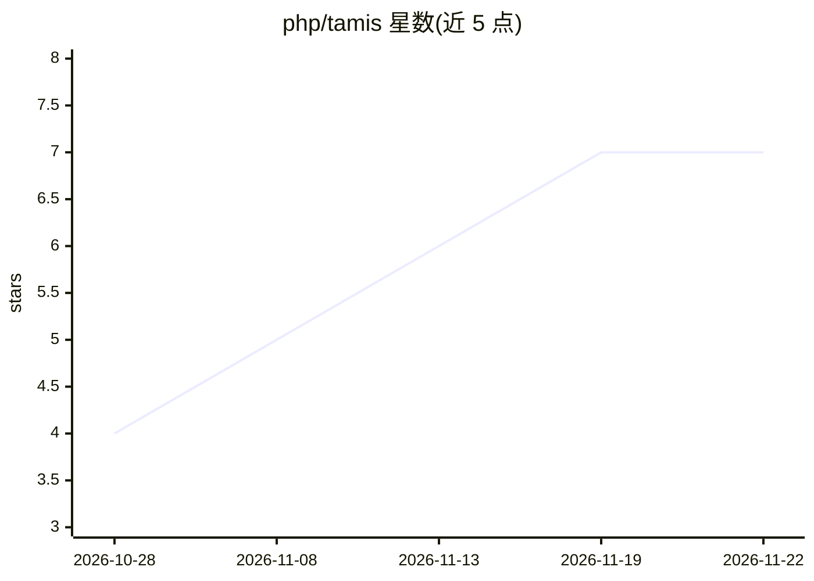

# php/tamis

⭐ 7 · Go · MIT · 推送 2026-11-16 · [GitHub](https://github.com/php/tamis) · 组织维护

**GitHub 安全公告的 LLM 初筛工具：为维护者预处理漏洞报告**

以 GitHub Actions 形式运行的 LLM agent，对新的私有漏洞报告做第一轮分诊：查重、定位已有修复或加固的公开 issue/PR、核验报告引用的文件与函数是否存在、检查安全政策中的排除条款，并给出 CWE 与 CVSS 4.0 基础向量建议，结果写入私有项目看板。agent 在隔离容器中运行，最终决策保留在维护者手中。安装需创建 GitHub App、配置密钥与 API key。

## 筛选速览

| 维度 | 判定 | 备注 |
|---|---|---|
| AI 角色 | `ai-native` | 本体是模型或模型工具 |
| 许可风险 | `permissive` | MIT |
| 部署形态 | `None` |  |
| 模型依赖 | — | README 未给出锁定关系 |
| 硬件要求 | — | 无带数字的原话,不猜 |
| 安装摩擦 | `low` | 无编译、无系统依赖或容器化 |
| 成熟度 | — | 结构信号不足 |

## 能力要点

- 对漏洞报告执行查重、代码核验、政策检查与修复溯源四类分析
- 生成 CWE 与 CVSS 4.0 base vector 建议
- agent 在 harness 驱动的隔离容器中运行
- 以 GitHub Action 发布，可固定 release tag 运行 attested 二进制

## 适用场景

- 为开源仓库自动初筛私有安全公告
- 维护者在人工评审前获得报告的预处理结论
- 在项目看板上集中查看分诊结果与严重度评估

## 场景标签

`网络安全` · 领域:学习与行业

## 证据(README 行号)

> L5: tamis does a first-pass triage of private vulnerability reports on GitHub. When a new security advisory arrives, an 
> L13: - suggests a CWE and a CVSS 4.0 base vector.
> L26: The agent runs in an isolated container driven by harness, the Alpha-Omega library behind scrutineer. Security desc

## 星数曲线

2026-10-28 4 → 2026-11-22 7（+3）

---
*卡片 v1 · prompt 1.4 · 生成 2026-11-20 · 置信度 high · 依据 README sha `9c433613ea2e` · [字段定义](../../DATASET.md)*
