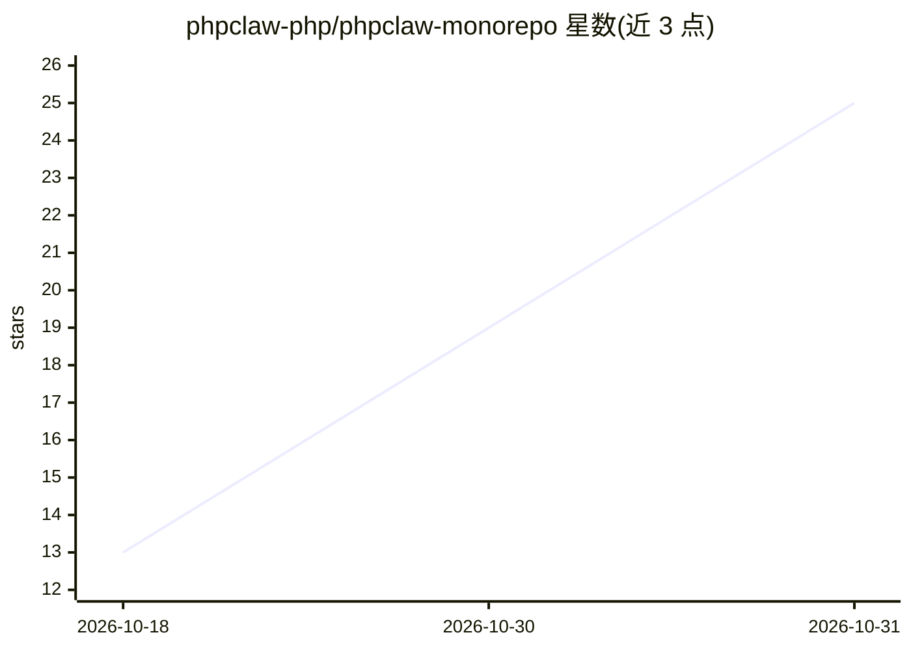

# phpclaw-php/phpclaw-monorepo

⭐ 25 · PHP · MIT · 推送 2026-10-16 · [GitHub](https://github.com/phpclaw-php/phpclaw-monorepo) · [官网](https://phpclaw.ai/) · 组织维护

**PHP 通用 AI agent 引擎：内置工具/记忆/安全防护与 ReAct 循环**

面向 PHP 开发者的 AI agent 框架：核心零框架依赖，仅要求 PHP 8.1+ 与 ext-curl/ext-json/ext-mbstring。内置 ReAct 循环（迭代上限默认 20）、可插拔工具/记忆/技能、Pipeline 与 Graph 链式编排（支持循环、人工暂停恢复、扇出）。7 个 LLM 提供商通过环境变量自动检测（Anthropic/OpenAI/Groq/Gemini/Mistral/DeepSeek/Ollama），另支持自定义 OpenAI 兼容端点。默认开启 8 个安全防护（提示注入/PII/代码注入等），ShellTool 仅允许白名单命令。提供 8 个框架/CMS 适配器（Laravel/Symfony/Drupal/WordPress 等）与 MCP server，不提供向量存储，非 RAG 框架。MIT 许可。

## 筛选速览

| 维度 | 判定 | 备注 |
|---|---|---|
| AI 角色 | `ai-ecosystem` | LLM/agent 周边工具 |
| 许可风险 | `permissive` | MIT |
| 部署形态 | `None` |  |
| 模型依赖 | local-ok | 支持本地模型 |
| 硬件要求 | — | 无带数字的原话,不猜 |
| 安装摩擦 | `low` | 无编译、无系统依赖或容器化 |
| 成熟度 | — | 结构信号不足 |

## 能力要点

- 内置 ReAct 循环、可插拔工具/记忆/技能与 Pipeline/Graph 编排
- 7 个 LLM 提供商环境变量自动检测，支持自定义 OpenAI 兼容端点
- 默认 8 个安全防护（提示注入/PII/破坏性 SQL 等）与工具输出净化
- 8 个框架/CMS 适配器（Laravel/Symfony/Drupal/Magento 等）与 MCP server

## 适用场景

- 在 Laravel/Symfony 等现有 PHP 应用中接入能调用 shell/HTTP/数据库工具的 agent
- 构建带安全防护与人工暂停/恢复的多步 agent 流程
- 通过 MCP server 将应用工具暴露给 Claude Desktop、Claude Code 或 Cursor

## 场景标签

`Agent 框架` · 领域:Agent 开发

## 证据(README 行号)

> L10:  The universal AI agent engine for PHP.
> L53: Every "AI in PHP" tutorial ends the same way: an HTTP client bolted onto a provider API, a hand-rolled tool-call lo

## 星数曲线

2026-10-18 13 → 2026-10-31 25（+12）

---
*卡片 v1 · prompt 1.4 · 生成 2026-10-30 · 置信度 high · 依据 README sha `e6aa4df00d0a` · [字段定义](../../DATASET.md)*
