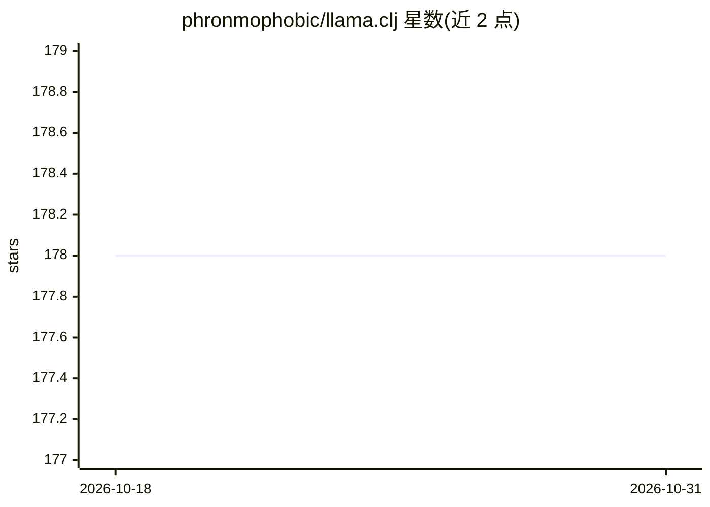

# phronmophobic/llama.clj

⭐ 178 · Clojure · MIT · 推送 2026-04-20 · [GitHub](https://github.com/phronmophobic/llama.clj) · 个人维护

**Clojure 的 llama.cpp 封装库，在本地运行 LLM**

通过 JNA/FFI 绑定调用 llama.cpp 共享库，使 Clojure 程序能在本地加载 GGUF 模型并生成文本、嵌入与元数据读取。原生依赖可从 clojars 拉取预编译库（Linux x86-64、macOS aarch64 等），也可本地编译 llama.cpp（需 git clone 并构建共享库）。支持 llama.cpp 的各后端（CPU/Metal 默认，CUDA/cuBLAS 需自行编译），FFI 绑定基于 b8833 版本，更新版本可能不兼容。ggml 模型支持已弃用。提供 CLI 与 API 参考文档。

## 筛选速览

| 维度 | 判定 | 备注 |
|---|---|---|
| AI 角色 | `ai-ecosystem` | LLM/agent 周边工具 |
| 许可风险 | `permissive` | MIT |
| 部署形态 | `None` |  |
| 模型依赖 | local-ok | 支持本地模型 |
| 硬件要求 | — | 无带数字的原话,不猜 |
| 安装摩擦 | `medium` | 含编译或系统依赖之一 |
| 成熟度 | — | 结构信号不足 |

## 能力要点

- Clojure 语言绑定 llama.cpp，加载 GGUF 模型生成文本
- 支持生成嵌入、chat 模板、读取模型元数据等 API
- clojars 预编译原生依赖（多平台）或本地编译两种方式
- 后端支持 CPU/Metal（预编译），cuBLAS 需本地编译

## 适用场景

- 在 Clojure 应用中本地运行 LLM 推理
- 通过 CLI 快速试用 GGUF 模型
- 在 JVM/Clojure 技术栈中集成 llama.cpp 生态的模型

## 场景标签

`推理引擎` · 领域:训练与推理

## 证据(README 行号)

> L3: Run LLMs locally. A clojure wrapper for llama.cpp.
> L38: llama.clj relies on the excellent llama.cpp library.
> L40: The llama.cpp shared library can either be compiled locally or can be included as a standalone maven dependency.

## 星数曲线

2026-10-18 178 → 2026-10-31 178（+0）

---
*卡片 v1 · prompt 1.4 · 生成 2026-10-23 · 置信度 high · 依据 README sha `676066eeda8f` · [字段定义](../../DATASET.md)*
