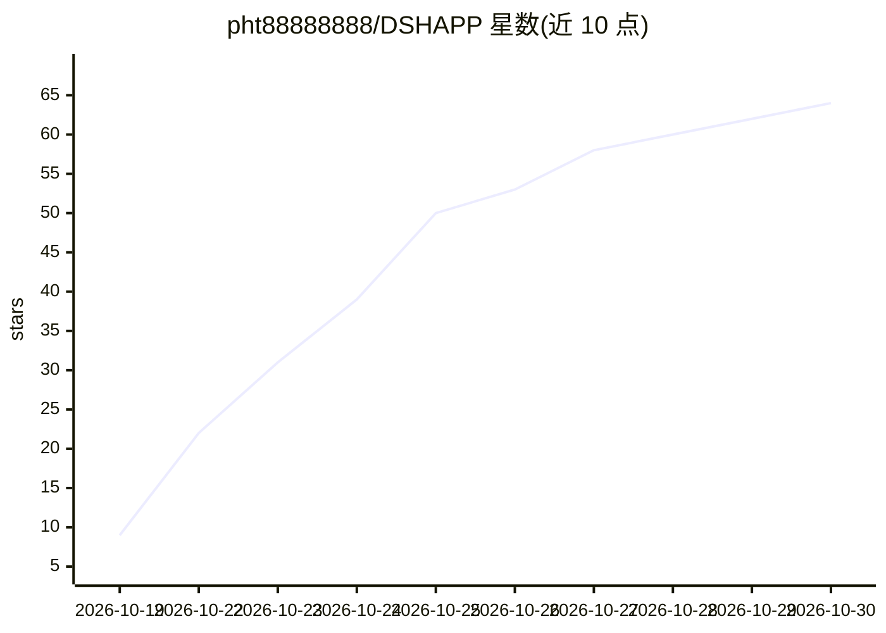

# pht88888888/DSHAPP

⭐ 64 · JavaScript · MIT · 推送 2026-10-29 · [GitHub](https://github.com/pht88888888/DSHAPP) · 个人维护 · 中文 README

**在 Android 手机上运行 DSH 编码 Agent 的宿主应用**

把 DSH（DeepSeek Harness）桌面端引擎打包进 Android：内置 Termux 环境运行 Node，在其上跑 DSH 引擎，并用 WebView/GeckoView 加载官方 Web GUI，不自绘聊天界面。提供 bash、文件读写、grep/glob、终端 PTY 等 Agent 能力，另有悬浮球、移动端窄屏适配、UI 调试工具与救援模式。通过 Releases 侧载 APK 安装，仅支持 arm64-v8a，targetSdk=28 导致无法上架 Google Play；从源码构建需 JDK 17 且需自备约 135 MB 构建资产。

## 筛选速览

| 维度 | 判定 | 备注 |
|---|---|---|
| AI 角色 | `ai-native` | 本体是模型或模型工具 |
| 许可风险 | `permissive` | MIT |
| 部署形态 | `None` |  |
| 模型依赖 | — | README 未给出锁定关系 |
| 硬件要求 | — | 无带数字的原话,不猜 |
| 安装摩擦 | `medium` | 含编译或系统依赖之一 |
| 成熟度 | — | 结构信号不足 |

## 能力要点

- 内置 Termux 环境 + Node 运行时承载 DSH 引擎
- 复用官方 Web GUI，双内核（系统 WebView / GeckoView）两包可同装
- 完整 Agent 能力：bash、文件读写、grep/glob、终端 PTY
- 四层救援模式与三层日志存储、诊断包一键导出

## 适用场景

- 在 Android 手机上运行完整的 AI 编码 Agent 而非只读聊天界面
- 老设备或系统 WebView 不可用时用 GeckoView 版运行
- 让模型自看屏幕点按钮做端到端 UI 自测

## 场景标签

`编码 Agent` · 领域:编码与开发

## 证据(README 行号)

> L9: DSH for Android 把 DSH（DeepSeek Harness）桌面端引擎
> L10: 原样搬进手机：内置 Termux 环境跑一个 Node，在 Node 上跑 DSH 引擎，再用 WebView
> L25: - **完整的 Agent 能力** —— `bash`、文件读写、`grep`/`glob`、终端 PTY 全部可用，

## 星数曲线

2026-10-19 9 → 2026-10-30 64（+55）

---
*卡片 v1 · prompt 1.4 · 生成 2026-10-24 · 置信度 high · 依据 README sha `8e45f2a94353` · [字段定义](../../DATASET.md)*
