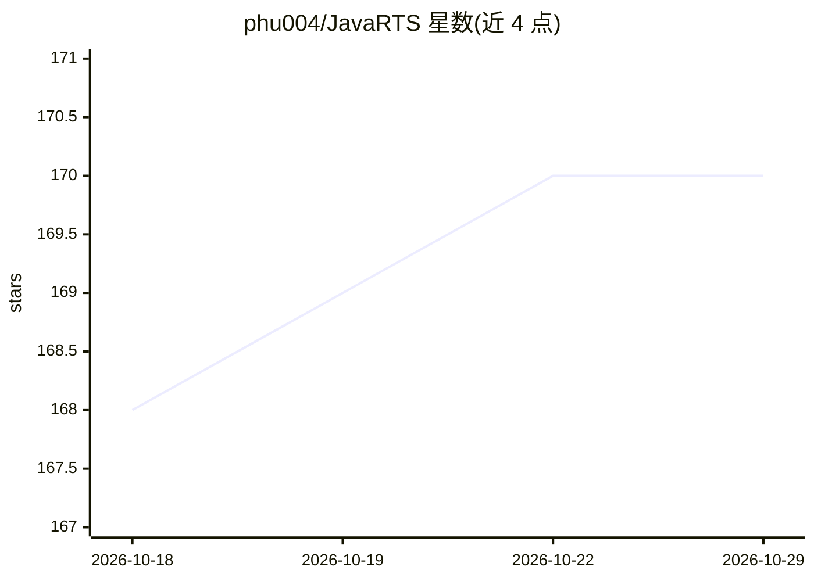

# phu004/JavaRTS

⭐ 170 · Java · 推送 2026-07-18 · [GitHub](https://github.com/phu004/JavaRTS) · 个人维护

**纯 Java 实现的简易 3D 即时战略游戏，带难度分级的 AI 对手**

个人爱好项目，用纯 Java 编写的即时战略（RTS）游戏：玩家对战内置 AI，AI 受战争迷雾与资源限制约束（无作弊），具备侦察、依玩家兵种调整编队、扩张矿点、集火残血单位、撤退、巡逻防守与针对静态防御的长程打击等行为，并按 normal/hard 难度分级。完赛后可向 Firebase 存储的全球在线排行榜提交成绩。Windows 包自带 JRE 点击 play.bat 运行，非 Windows 用户需自行安装 Java。

## 筛选速览

| 维度 | 判定 | 备注 |
|---|---|---|
| AI 角色 | `ai-enhanced` | 去掉 AI 部分产品仍成立 |
| 许可风险 | `none` | — |
| 部署形态 | `None` |  |
| 模型依赖 | — | README 未给出锁定关系 |
| 硬件要求 | — | 无带数字的原话,不猜 |
| 安装摩擦 | `low` | 无编译、无系统依赖或容器化 |
| 成熟度 | — | 结构信号不足 |

## 能力要点

- AI 不作弊，受战争迷雾与资源采集限制约束
- 侦察—情报—调整兵种与进攻决策的行为链（normal/hard）
- 战斗中集火残血单位、撤退与基地巡逻等难度分级行为
- Firebase 全球在线排行榜，按难度分别排名

## 适用场景

- 直接下载运行一款轻量 RTS 单机对战 AI
- 参考纯 Java 实现的 RTS 与游戏 AI 源码和素材
- 挑战不同难度并提交排行榜成绩

## 场景标签

 · 领域:游戏/桌面娱乐

## 证据(README 行号)

> L2: My hobby project, trying to create a simple RTS game with somewhat challenging AI with only Java.
> L13: - AI does not cheat, its vision is limited by fog of war, and it doesn't have any advantage in resource gathering.

## 星数曲线

2026-10-18 168 → 2026-10-29 170（+2）

---
*卡片 v1 · prompt 1.4 · 生成 2026-10-22 · 置信度 high · 依据 README sha `d0bb7aa6d04e` · [字段定义](../../DATASET.md)*
