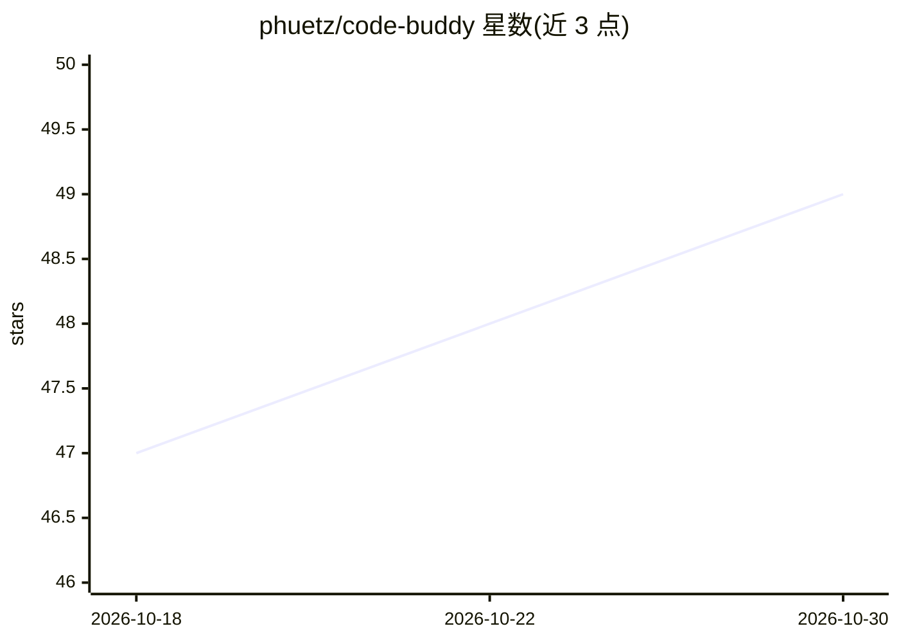

# phuetz/code-buddy

⭐ 49 · TypeScript · NOASSERTION · 推送 2026-10-12 · [GitHub](https://github.com/phuetz/code-buddy) · [官网](https://phuetz.github.io/code-buddy/) · 个人维护

**终端本地优先的 AI 编码 agent，支持 64 个 LLM 提供方**

面向开发者的终端编码 agent：读取仓库、写代码、运行命令，支持云端、网关与本地模型路由（含 Ollama 本地路径，$0 无 API 账单），多模型 council 按任务类型记录可信模型。提供 peer-to-peer fleet hub（远程只读工具三重门控）、Electron 桌面应用 Cowork（单独安装，需 Node ≥22）、Rust 感知守护进程（音频/视觉/屏幕）及四层可学习表面（经验/自写工具/技能/策略，经验门控回滚）。通过 npm 全局安装，声明最低 Node 20、推荐 22/24；许可为 Business Source License 1.1。README 设"Not ready"一节列明集成限制。

## 筛选速览

| 维度 | 判定 | 备注 |
|---|---|---|
| AI 角色 | `ai-native` | 本体是模型或模型工具 |
| 许可风险 | `none` | NOASSERTION |
| 部署形态 | `library` | 以包/库形式分发 |
| 模型依赖 | local-ok | 支持本地模型 |
| 硬件要求 | — | 无带数字的原话,不猜 |
| 安装摩擦 | `medium` | 含编译或系统依赖之一 |
| 成熟度 | — | 结构信号不足 |

## 能力要点

- 64 个 LLM 提供方路由，30 个免费或本地 $0
- buddy loop 以验证命令退出 0 为完成判定，非模型自述
- 自我改进提案经快照实证评分，回归即回滚，且不改自身 src/
- fleet 远程工具经 allowlist、fleetSafe 标志与 fail-closed 工作区根三重门控

## 适用场景

- 在终端让 agent 修测试、改代码并自动验证
- 用 Ollama 本地模型零 API 费用做编码任务
- 多机 peer 组队调用彼此模型与只读工具
- 在 Claude Code 中以插件方式调用 buddy 的工具与技能

## 场景标签

`编码 Agent` · 领域:编码与开发

## 证据(README 行号)

> L3: **A local-first AI coding agent that can also run as a fleet, a desktop app, and a companion.**
> L4: It reads your repository, writes code, runs commands, and you can watch it work — on your machine,
> L38: Code Buddy combines a terminal coding agent with cloud, gateway and local model routing,

## 星数曲线

2026-10-18 47 → 2026-10-30 49（+2）

---
*卡片 v1 · prompt 1.4 · 生成 2026-10-25 · 置信度 high · 依据 README sha `ecbed90642bf` · [字段定义](../../DATASET.md)*
