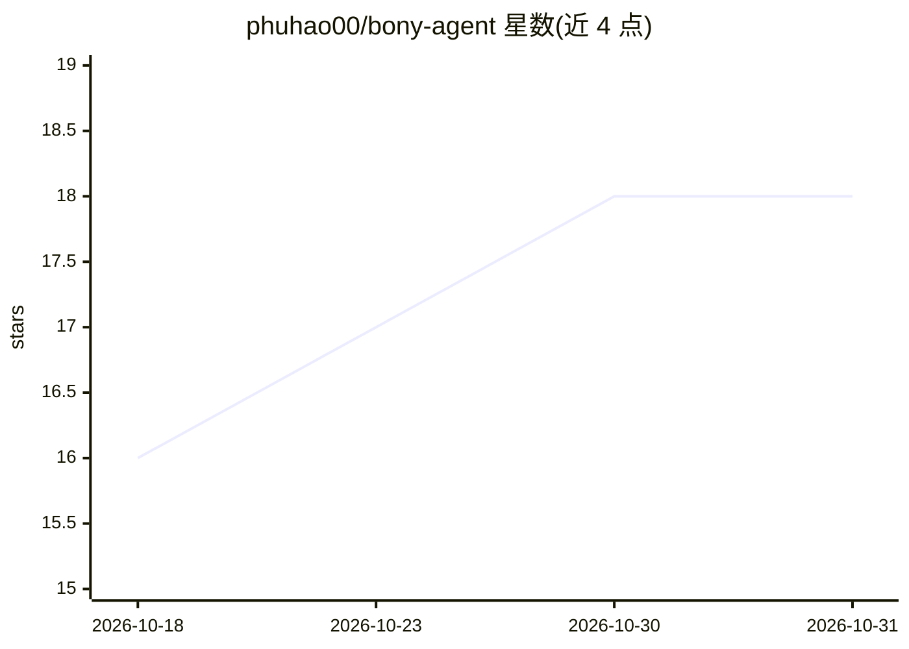

# phuhao00/bony-agent

⭐ 18 · Python · 推送 2026-10-05 · [GitHub](https://github.com/phuhao00/bony-agent) · [官网](https://github.com/phuhao00/bony-agent) · 个人维护 · 中文 README

**个人运营者的全链路 AI 内容生产与多平台自动分发平台**

FastAPI + Next.js + LangGraph 构建的内容自动化平台：覆盖 AI 对话、图片/视频/音乐/短剧/播客生成、11 种图片编辑模式、RAG 知识库，以及通过 Playwright 向小红书、抖音、YouTube、Twitter 等 14 个平台自动发布；支持 APScheduler 定时调度、27+ 专业 Agent（LangGraph Supervisor 编排）、54+ 技能文件与 MCP 协议客户端。面向希望单人完成内容选题到发布全流程的创作者与运营者。提供 macOS DMG 桌面包、源码启动脚本与 Docker 部署三种方式，运行需至少一个大模型 API Key，平台发布需自行配置 Cookie/Token。

## 筛选速览

| 维度 | 判定 | 备注 |
|---|---|---|
| AI 角色 | `ai-native` | 本体是模型或模型工具 |
| 许可风险 | `permissive` | — |
| 部署形态 | `desktop` | 安装包/桌面程序 |
| 模型依赖 | locked-api |  |
| 硬件要求 | — | 无带数字的原话,不猜 |
| 安装摩擦 | `low` | 无编译、无系统依赖或容器化 |
| 成熟度 | — | 结构信号不足 |

## 能力要点

- 图/视频/音乐/短剧/播客多模态生成与 11 种图片编辑模式
- Playwright 自动化发布到 14 个平台，APScheduler 定时调度
- 27+ 专业 Agent 经 LangGraph Supervisor 编排协作
- 54+ SKILL.md 格式技能与 MCP 协议客户端

## 适用场景

- 我一个人想完成从选题、生成到多平台发布的短视频全流程
- 按定时计划结合热点自动生成并发布内容到各平台矩阵
- 搭建私有 RAG 知识库供 AI 对话检索
- 用 AI 客服助手处理游戏、电商场景的咨询

## 场景标签

`多智能体` `浏览器自动化` `视频生成` `RAG` · 领域:Agent 开发

## 证据(README 行号)

> L3: > 一站式 AI 驱动的内容自动化平台：文案 → 图片/视频/音乐/短剧生成 → 自动定时发布到全平台矩阵。
> L72: |📢 平台自动发布|Playwright 浏览器自动化，支持 **14** 个平台：小红书、抖音、B站、微博、快手、视频号、YouTube、Twitter/X、TikTok、Discord、飞书等|
> L75: |🤝 多 Agent 协作|LangGraph Supervisor 编排，**27+** 专业 Agent 协同工作|

## 星数曲线

2026-10-18 16 → 2026-10-31 18（+2）

---
*卡片 v1 · prompt 1.4 · 生成 2026-10-29 · 置信度 high · 依据 README sha `ed9b9ca0635f` · [字段定义](../../DATASET.md)*
