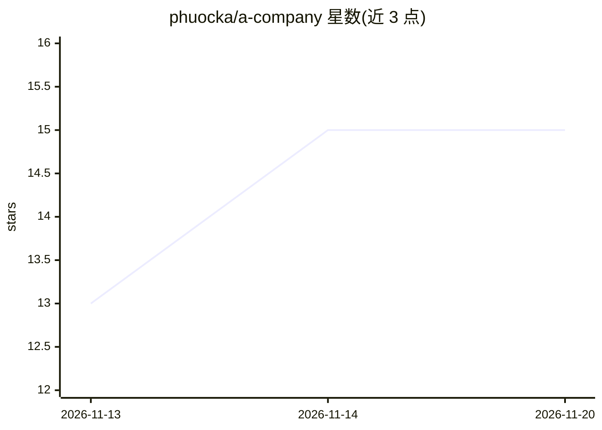

# phuocka/a-company

⭐ 15 · TypeScript · Apache-2.0 · 推送 2026-11-14 · [GitHub](https://github.com/phuocka/a-company) · [官网](https://github.com/phuocka/a-company#readme) · 个人维护

**自托管多 agent AI 队友平台：Web/桌面/移动端持久机器人**

覆盖 Web、Electron 桌面与 Expo 移动端的自托管 AI agent 平台。提供带持久记忆（MEMORY.md）的机器人、可隔离的 Linux 计算机沙箱（Docker/E2B/Daytona/Box）、定时例程、聊天内 HTML mini-app、token 消费上限与入站 webhook。模型接入支持云 API（经 Pi：Anthropic、OpenAI、OpenRouter 等）、本地推理（Ollama/LM Studio/vLLM/llama.cpp）及复用本地 Claude Code/Codex/Gemini CLI 登录。三种运行方式：Windows ZIP 解压即用、Zero-Docker Lite CLI（内嵌 PGlite）、多用户 Docker Compose 服务器。Apache-2.0，构建未签名，Linux AppImage 未发布。

## 筛选速览

| 维度 | 判定 | 备注 |
|---|---|---|
| AI 角色 | `ai-ecosystem` | LLM/agent 周边工具 |
| 许可风险 | `permissive` | Apache-2.0 |
| 部署形态 | `desktop` | 安装包/桌面程序 |
| 模型依赖 | local-ok | 支持本地模型 |
| 硬件要求 | — | 无带数字的原话,不猜 |
| 安装摩擦 | `low` | 无编译、无系统依赖或容器化 |
| 成熟度 | — | 结构信号不足 |

## 能力要点

- 三端客户端共享同一 Hono+oRPC API，三种部署模式同源
- 复用本地 Claude Code/Codex/Gemini CLI/OpenCode 登录，零额外 API 成本
- 机器人沙箱（Docker/E2B/Daytona/Box）与 CDP 接入已登录 Chrome
- token 日/月消费硬上限、Markdown 团队蓝图与 webhook 唤醒

## 适用场景

- 自建多机器人团队处理工程、研究、内容等例行任务
- 限制并审计各机器人的 token 开销
- 通过 webhook 从外部系统触发机器人任务

## 场景标签

`多智能体` `AI 助手` · 领域:Agent 开发

## 证据(README 行号)

> L53: |**Provider-Neutral + Local CLIs**|Connect cloud APIs via Pi, point to Ollama/LM Studio, or reuse local **Claude Co
> L151: - **Zero-Cost Local Subscription CLIs:** `claude-cli` (`ACOMPANY_CLAUDE_CLI_PATH`), `codex-cli` (`ACOMPANY_CODEX_C
> L153: - **Self-Hosted / Local Inference:** Ollama, LM Studio, vLLM, llama.cpp, or any custom OpenAI-compatible endpoint.

## 星数曲线

2026-11-13 13 → 2026-11-20 15（+2）

---
*卡片 v1 · prompt 1.4 · 生成 2026-11-18 · 置信度 mid · 依据 README sha `8f06d495d2fb` · [字段定义](../../DATASET.md)*
