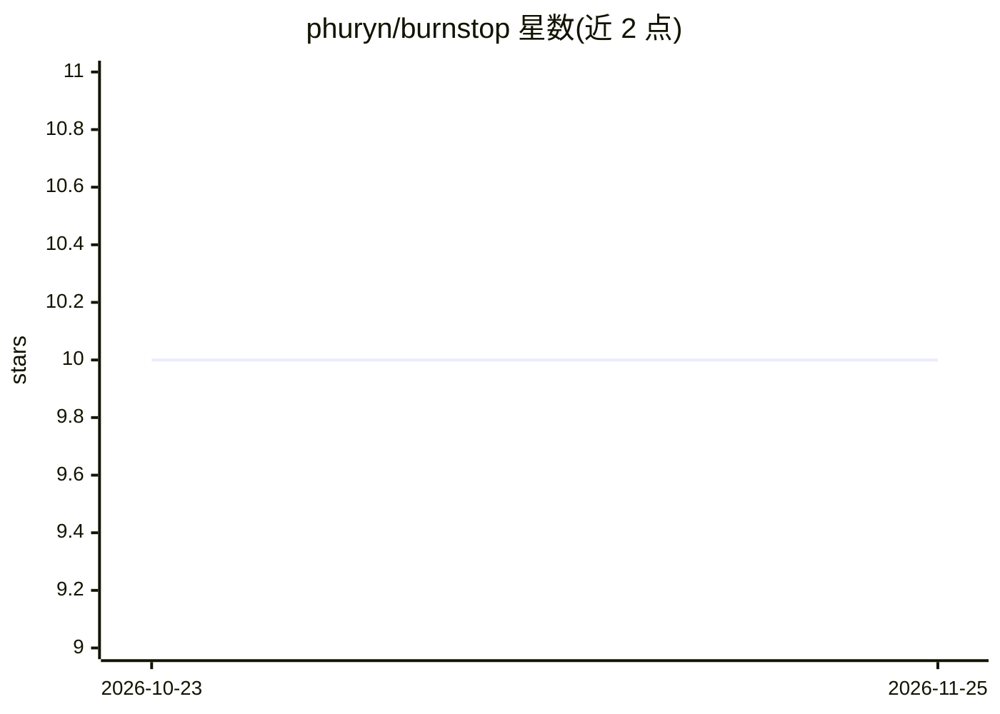

# phuryn/burnstop

⭐ 10 · Python · MIT · 推送 2026-06-22 · [GitHub](https://github.com/phuryn/burnstop) · 个人维护

**给 Claude Code 会话加 token/美元预算熔断的工具**

以 Claude Code 插件或本地脚本安装，通过原生 Stop hook 在每轮从本地转录文件重算会话花费（含 subagent），超过设定的美元或 token 上限即返回 continue:false 干净地中止运行，并可覆盖 /goal 循环；同时检测重复工具调用的结构性循环。/goal 启动时自动挂载 $50 上限。无需代理、API key 或网络请求，数据不出本机。Python 3.8+ 标准库即可运行，无构建步骤。

## 筛选速览

| 维度 | 判定 | 备注 |
|---|---|---|
| AI 角色 | `ai-ecosystem` | LLM/agent 周边工具 |
| 许可风险 | `permissive` | MIT |
| 部署形态 | `library` | 以包/库形式分发 |
| 模型依赖 | — | README 未给出锁定关系 |
| 硬件要求 | — | 无带数字的原话,不猜 |
| 安装摩擦 | `low` | 无编译、无系统依赖或容器化 |
| 成熟度 | — | 结构信号不足 |

## 能力要点

- Stop hook 逐轮从本地转录重算花费，超限即中止运行并覆盖 /goal
- 预算支持美元与 token 两种单位，自动计入 subagent 花费
- /goal 启动时自动挂载 $50 默认上限，可用 /budget-default 修改
- 结构循环检测：同一工具调用重复时触发熔断

## 适用场景

- 让 Claude Code 的 /goal 长时间自主运行时防止预算失控
- 多 agent 并发场景下统一计入 subagent 花费并设总上限
- 离线/隐私敏感环境下做本地用量控制，不上传任何数据

## 场景标签

 · 领域:LLM 使用管理/成本治理

## 证据(README 行号)

> L9: > Cap a Claude Code session in **tokens or dollars**. When spend crosses the line — your subagents counted — the run
> L13: Native hook. No proxy, no API key, nothing leaves your machine, fully within Anthropic's Terms of Service.
> L64: A `Stop` hook recomputes spend from Claude Code's own local transcripts each turn (no ledger, nothing written durin

## 星数曲线

2026-10-23 10 → 2026-11-25 10（+0）

---
*卡片 v1 · prompt 1.4 · 生成 2026-11-19 · 置信度 mid · 依据 README sha `95dfe917f7f6` · [字段定义](../../DATASET.md)*
