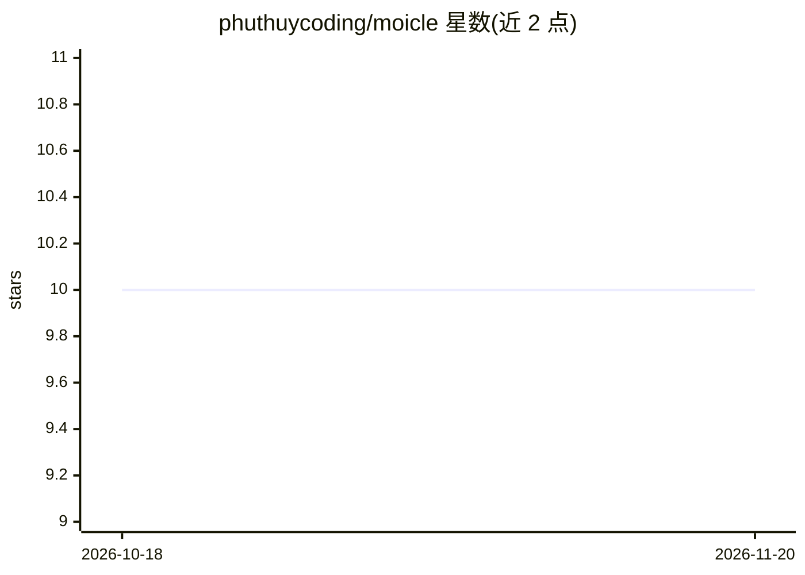

# phuthuycoding/moicle

⭐ 10 · TypeScript · MIT · 推送 2026-09-29 · [GitHub](https://github.com/phuthuycoding/moicle) · 个人维护

**为 AI 编码工具提供可复用的 agent、命令、技能与架构参考包**

一个通过 npm 分发的工具包，为 Claude Code、Codex CLI、Antigravity、Cursor、Devin CLI、Windsurf 安装 18 个 agent、2 个命令、10 个技能和 9 份架构参考文档（DDD/六边形/技术栈模式）。提供 moicle CLI 进行交互式安装、启用/禁用、卸载与清单化管理；agent 被调用时会先读取架构文件再编码。要求 Node.js >= 18 与 Claude Code CLI，许可为 GPL-3.0。

## 筛选速览

| 维度 | 判定 | 备注 |
|---|---|---|
| AI 角色 | `ai-ecosystem` | LLM/agent 周边工具 |
| 许可风险 | `permissive` | MIT |
| 部署形态 | `library` | 以包/库形式分发 |
| 模型依赖 | — | README 未给出锁定关系 |
| 硬件要求 | — | 无带数字的原话,不猜 |
| 安装摩擦 | `low` | 无编译、无系统依赖或容器化 |
| 成熟度 | — | 结构信号不足 |

## 能力要点

- 18 个 agent + 10 个模式化技能 + 2 个向导命令 + 9 份架构参考
- 支持安装到 Claude Code/Codex CLI/Antigravity/Cursor/Devin CLI/Windsurf 六个目标
- moicle install 写入 manifest，uninstall 按清单精确移除
- agent 调用时先读取架构参考文件以保持结构一致

## 适用场景

- 为团队统一 AI 编码工具的架构规范与工作流
- 用 /bootstrap 向导按 5 种技术栈初始化新项目
- 按需启用/禁用 agent 与技能，避免文件残留

## 场景标签

`编码 Agent` `Agent 框架` · 领域:Agent 开发

## 证据(README 行号)

> L9: > Reusable AI agents, commands, skills, and architecture references for Claude Code
> L13: A toolkit to bootstrap and accelerate project development with Claude Code through specialized agents, automation c
> L17: - **18 AI Agents** - 6 developer agents + 12 utility agents

## 星数曲线

2026-10-18 10 → 2026-11-20 10（+0）

---
*卡片 v1 · prompt 1.4 · 生成 2026-11-19 · 置信度 high · 依据 README sha `9cef1ac0fdb0` · [字段定义](../../DATASET.md)*
