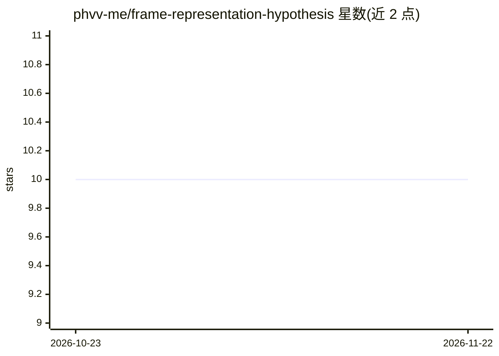

# phvv-me/frame-representation-hypothesis

⭐ 10 · Jupyter Notebook · MIT · 推送 2026-10-26 · [GitHub](https://github.com/phvv-me/frame-representation-hypothesis) · [官网](https://phvv.me/frame-representation-hypothesis/) · 组织维护

**LLM 可解释性与概念引导生成论文的官方代码库**

Frame Representation Hypothesis 论文（TACL/EMNLP2025）的官方仓库，围绕用 WordNet 生成概念来引导 LLM 文本生成并暴露偏见或漏洞的方法。论文中每个实验对应一个 Jupyter notebook（从 02 开始）。支持多 token 词处理，可用 OMW 50M 词数据集构建 10 万个概念，在 Llama 3.1、Gemma 2、Phi 3 上测试。安装走 git clone 加 uv/pip，也提供 Docker 镜像；运行需 Hugging Face 访问令牌及对 models.yaml 中各门控模型的下载授权。

## 筛选速览

| 维度 | 判定 | 备注 |
|---|---|---|
| AI 角色 | `ai-knowledge` | 知识聚合/清单类 |
| 许可风险 | `permissive` | MIT |
| 部署形态 | `library` | 以包/库形式分发 |
| 模型依赖 | — | README 未给出锁定关系 |
| 硬件要求 | — | 无带数字的原话,不猜 |
| 安装摩擦 | `medium` | 含编译或系统依赖之一 |
| 成熟度 | — | 结构信号不足 |

## 能力要点

- 论文全部实验以 Jupyter notebook 形式提供
- 基于 WordNet 生成概念，支持引导文本生成与暴露偏见/漏洞
- 可用 OMW 50M 词数据集构建 100,000 个概念
- 提供 Docker 镜像运行方式

## 适用场景

- 复现论文中的可解释性实验
- 用概念引导方式控制 LLM 文本生成
- 检测模型中的偏见或漏洞

## 场景标签

`科研工具` · 领域:学习与行业

## 证据(README 行号)

> L1: # 🎌 Frame Representation Hypothesis (TACL/EMNLP2025)
> L5: The Frame Representation Hypothesis is a robust framework for understanding and controlling LLMs. We use WordNet to 
> L54: Each experiment in the paper is in one of the jupyter notebooks starting from 02.

## 星数曲线

2026-10-23 10 → 2026-11-22 10（+0）

---
*卡片 v1 · prompt 1.4 · 生成 2026-11-19 · 置信度 high · 依据 README sha `a8ec3cde4843` · [字段定义](../../DATASET.md)*
