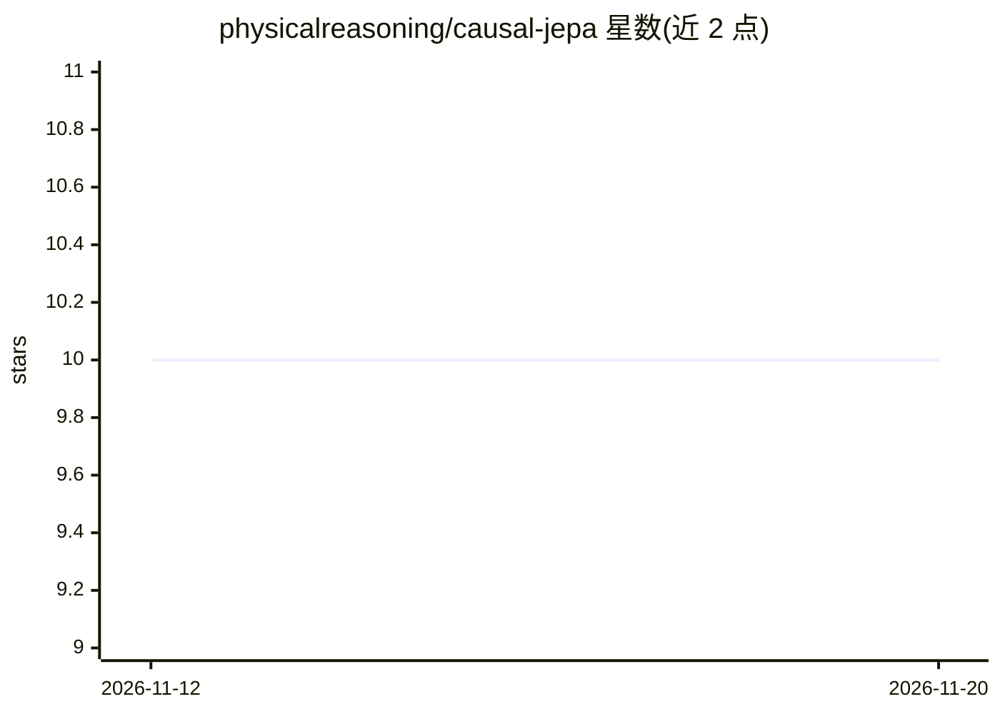

# physicalreasoning/causal-jepa

⭐ 10 · Python · Apache-2.0 · 推送 2026-10-12 · [GitHub](https://github.com/physicalreasoning/causal-jepa) · [官网](https://physicalreasoning.ai/blog/we-tried-to-break-our-own-diagnostic/) · 个人维护

**JEPA 在预测市场任务上的预注册阴性结果与复现脚本集**

在 Kalshi 加密货币小时事件重建的 24 档行权价阶梯语料（25,818 窗口）上训练因果轴 JEPA，结论是学到的表征不优于原始特征。通过预注册的决策门与多项对照（原始特征、维度匹配、未训练编码器）逐项排除解释，最终定位到评测指标主要在测量输入重构。提供 61 个测试与 10 个实验脚本，结果以 JSON 提交，语料可从 Kalshi 公开 API 重建。限制：单一语料、单一资产类别、1.8M 参数的编码器。

## 筛选速览

| 维度 | 判定 | 备注 |
|---|---|---|
| AI 角色 | `ai-knowledge` | 知识聚合/清单类 |
| 许可风险 | `permissive` | Apache-2.0 |
| 部署形态 | `library` | 以包/库形式分发 |
| 模型依赖 | — | README 未给出锁定关系 |
| 硬件要求 | — | 无带数字的原话,不猜 |
| 安装摩擦 | `medium` | 含编译或系统依赖之一 |
| 成熟度 | — | 结构信号不足 |

## 能力要点

- 预注册四项失败解释假设并逐项证伪，决策门与 kill 准则预先记录于 docs/RESEARCH_PLAN.md
- 冻结编码器 + ridge/MLP 探针评测，配三重对照（原始特征/维度匹配/未训练编码器）
- 语料可从 Kalshi 无鉴权公开 API 无凭据重建；无语料时 61 个测试中 36 个仍可运行
- 含时间注意力子层的 KV cache 实现与因子化编码器（strike attention + time attention）

## 适用场景

- 复现自监督表征学习在时间序列上的阴性结果实验
- 研究探针评测指标中输入重构泄漏的诊断方法
- 从 Kalshi 公开 API 构建行权价阶梯时间序列语料

## 场景标签

`模型评测` `科研工具` · 领域:评测与运维

## 证据(README 行号)

> L6:  A negative result, and the diagnostics that failed to predict it.
> L21: The programme is closed. It is published because the way it failed is more useful than the way it
> L103: The ten experiments, in the order they ran. Each maps to a finding in

## 星数曲线

2026-11-12 10 → 2026-11-20 10（+0）

---
*卡片 v1 · prompt 1.4 · 生成 2026-11-19 · 置信度 mid · 依据 README sha `651aa7c65806` · [字段定义](../../DATASET.md)*
