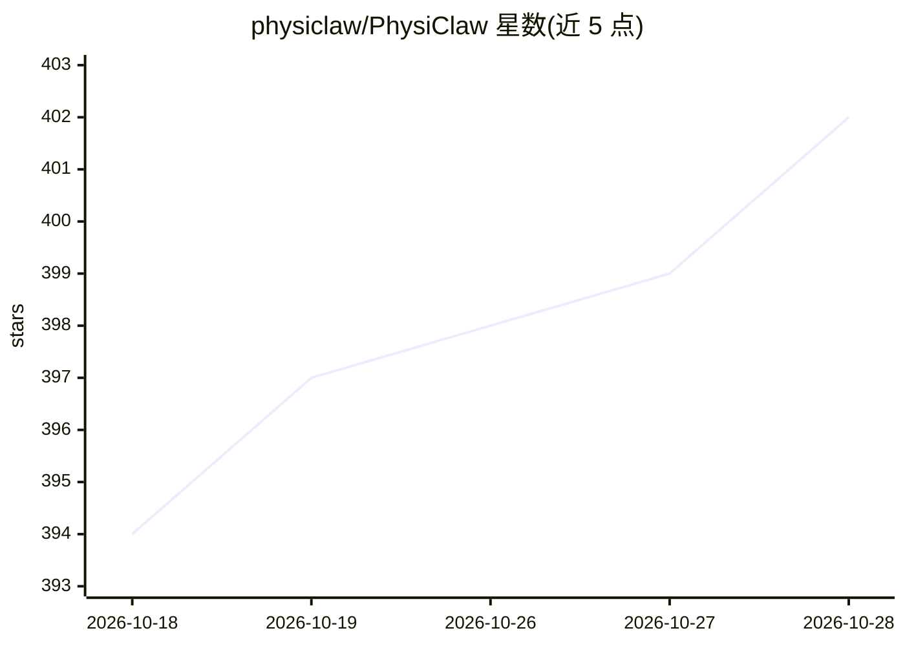

# physiclaw/PhysiClaw

⭐ 402 · Python · MIT · 推送 2026-10-27 · [GitHub](https://github.com/physiclaw/PhysiClaw) · [官网](https://physiclaw.ai) · 组织维护 · 中文 README

**用机械臂+摄像头实体操控手机的具身 AI 代理**

PhysiClaw 是一个具身 AI 代理：通过摄像头读取手机屏幕、用触控笔以物理点击方式操作手机，不依赖 API、OAuth 或 ADB，手机端无需安装任何软件。用户将专用手机上的 WhatsApp 账号加为联系人，用自然语言下达任务（点外卖、购物、叫车、回消息等），代理的运行时循环按计划任务或新消息唤醒，解锁手机执行任务并在涉及支付等操作时暂停确认。代价是速度：每个动作耗时数秒。使用需要 PhysiClaw 硬件（机械臂、触控笔、摄像头）及一部 iPhone；CLI 跨 macOS/Windows/Linux。CAD 与软件均以 MIT 许可。

## 筛选速览

| 维度 | 判定 | 备注 |
|---|---|---|
| AI 角色 | `ai-native` | 本体是模型或模型工具 |
| 许可风险 | `permissive` | MIT |
| 部署形态 | `None` |  |
| 模型依赖 | — | README 未给出锁定关系 |
| 硬件要求 | — | 无带数字的原话,不猜 |
| 安装摩擦 | `low` | 无编译、无系统依赖或容器化 |
| 成熟度 | — | 结构信号不足 |

## 能力要点

- 摄像头读屏+触控笔物理点击，手机端零安装、无 API/ADB 依赖
- 通过 WhatsApp 用自然语言下达任务，运行时按计划或新消息唤醒执行
- 涉及支付等关键操作时暂停等待确认
- MIT 许可，含 CAD-as-code 硬件与代理软件

## 适用场景

- 让代理代替我在手机上完成点外卖、买菜、叫车等日常事务
- 在无公开 API 的封闭 App 上执行自动化操作
- 通过 WhatsApp 对话远程指挥代理执行定时任务

## 场景标签

`GUI 自动化` · 领域:效率与自动化

## 证据(README 行号)

> L9: PhysiClaw watches a phone's screen with a camera and taps it with a stylus,
> L43: or the screen lights up with a new message. The agent unlocks the phone, reads

## 星数曲线

2026-10-18 394 → 2026-10-28 402（+8）

---
*卡片 v1 · prompt 1.4 · 生成 2026-10-21 · 置信度 mid · 依据 README sha `6f5c6aaf661c` · [字段定义](../../DATASET.md)*
