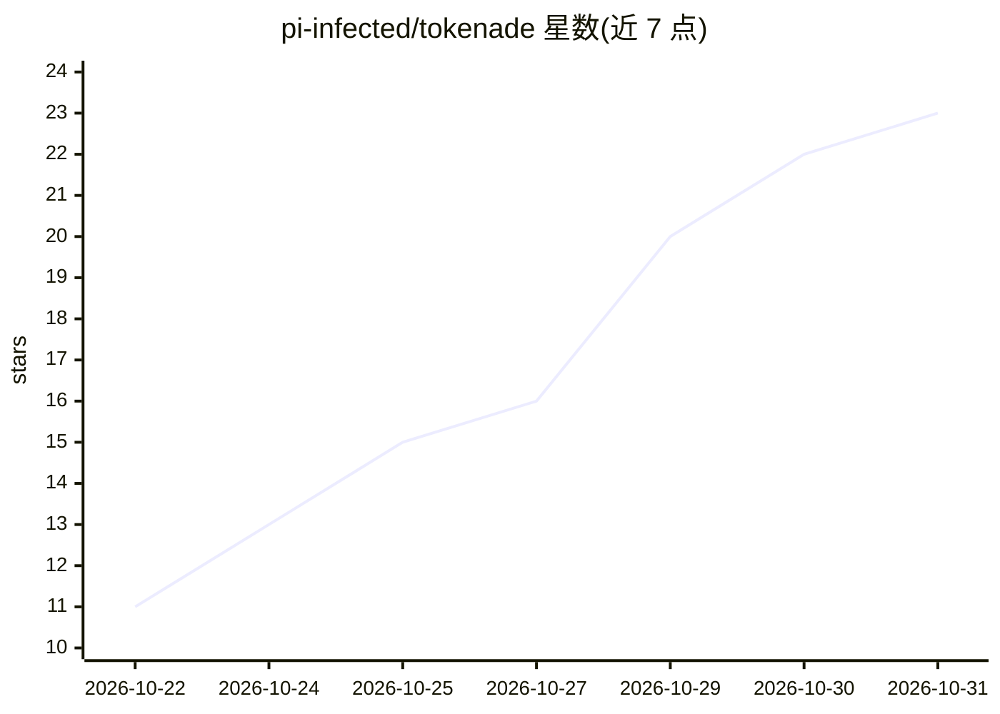

# pi-infected/tokenade

⭐ 23 · Rust · Apache-2.0 · 推送 2026-10-21 · [GitHub](https://github.com/pi-infected/tokenade) · [官网](https://tokenade.net) · 组织维护

**本地拦截 AI 编程代理流量、折叠冗余内容以降低 token 消耗的工具**

用 Rust 编写的单个二进制程序，部署在编程代理（Claude Code、Codex、Cursor、Copilot CLI 等）与模型之间：在计费前折叠构建日志、整文件读取、冗长 MCP 载荷和重复上下文，所有折叠内容携带哈希、可通过 expand-ref 恢复。另提供代码检索（map/query/semantic）、网页压缩、密钥脱敏与本地节省看板。支持 npm 预编译安装或 cargo 源码构建，语义检索模型首次使用时从 Hugging Face 下载。对 7 个代理提供完整集成，其余代理为部分功能。

## 筛选速览

| 维度 | 判定 | 备注 |
|---|---|---|
| AI 角色 | `ai-ecosystem` | LLM/agent 周边工具 |
| 许可风险 | `permissive` | Apache-2.0 |
| 部署形态 | `library` | 以包/库形式分发 |
| 模型依赖 | — | README 未给出锁定关系 |
| 硬件要求 | — | 无带数字的原话,不猜 |
| 安装摩擦 | `low` | 无编译、无系统依赖或容器化 |
| 成熟度 | — | 结构信号不足 |

## 能力要点

- 命令输出压缩、读取去重、MCP 载荷压缩与工具清单裁剪
- 每次折叠携带哈希，tokenade expand-ref 可恢复原始字节
- map/query/skeleton/semantic 等代码检索，避免整文件读取
- 账本与看板保留在本机，自动更新经签名校验

## 适用场景

- 降低 Claude Code/Codex/Cursor 等编程代理的长会话 token 费用
- 让代理读长构建日志时只看到失败与关键行
- 在不改动工作流的情况下压缩 MCP 响应与重复上下文

## 场景标签

`语义搜索` · 领域:知识与检索

## 证据(README 行号)

> L20: Tokenade is a single Rust binary that sits between your coding agent (Claude
> L21: Code, Codex, Cursor, Copilot CLI, OpenCode, Kilo Code, Qwen Code…) and the

## 星数曲线

2026-10-22 11 → 2026-10-31 23（+12）

---
*卡片 v1 · prompt 1.4 · 生成 2026-10-28 · 置信度 high · 依据 README sha `a8fa98a1c04d` · [字段定义](../../DATASET.md)*
