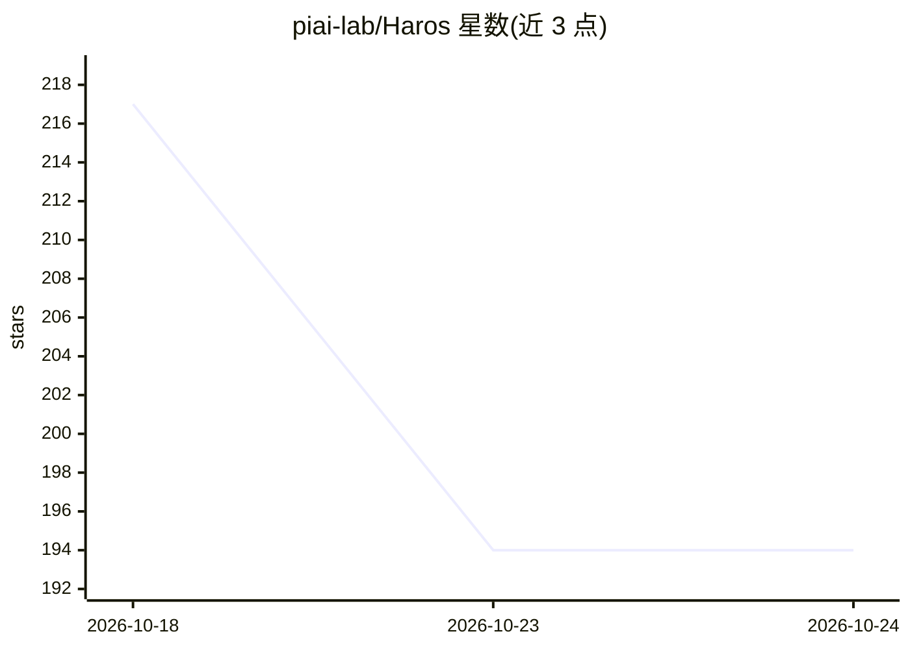

# piai-lab/Haros

⭐ 194 · TypeScript · Apache-2.0 · 推送 2026-09-22 · [GitHub](https://github.com/piai-lab/Haros) · 组织维护 · 中文 README

**本地优先桌面工作台：在同一会话中接入并切换多种编码 Agent**

基于 Electron 的开源 agent 工作台（Harness OS），将 Codex、Claude Code、Cursor、Grok、DeepSeek 等 10 种 agent Harness 接入同一桌面界面：可在同一对话中切换 Harness 并传递上下文，项目、会话与工作历史保存在本地。各 Harness 保留原生模型、认证与配置，可用性取决于其自身安装情况。支持 macOS/Windows/Linux，提供 Releases 下载，也可用 Bun 从源码构建运行；切换时仅传递消息上下文，不迁移原 Harness 私有会话状态。

## 筛选速览

| 维度 | 判定 | 备注 |
|---|---|---|
| AI 角色 | `ai-ecosystem` | LLM/agent 周边工具 |
| 许可风险 | `permissive` | Apache-2.0 |
| 部署形态 | `None` |  |
| 模型依赖 | locked-api |  |
| 硬件要求 | — | 无带数字的原话,不猜 |
| 安装摩擦 | `medium` | 含编译或系统依赖之一 |
| 成熟度 | — | 结构信号不足 |

## 能力要点

- 同一对话内切换 10 种 Harness 并传递先前上下文
- 各 Harness 保留原生模型、认证与配置
- 项目、会话与工作历史集中保存在本地工作台
- macOS/Windows/Linux 三平台桌面构建（NSIS/AppImage/.app）

## 适用场景

- 在不同编码任务中切换 Codex、Claude Code 等 Agent 而不迁移项目
- 把多个 Agent 的会话与工作历史集中在一处管理
- 在 Studio 独立输出工作区中产出交付物

## 场景标签

`编码 Agent` · 领域:编码与开发

## 证据(README 行号)

> L21: Haros is an open-source workbench for agent Harnesses. Use Codex, Claude Code, and other Harnesses
> L39: A Harness is a complete agent runtime, not just a model. Haros also calls these runtimes **Engines**.
> L115: You can switch Harnesses in the same Haros conversation. Haros passes prior user and assistant

## 星数曲线

2026-10-18 217 → 2026-10-24 194（-23）

---
*卡片 v1 · prompt 1.4 · 生成 2026-10-22 · 置信度 high · 依据 README sha `146c6ace3c0c` · [字段定义](../../DATASET.md)*
