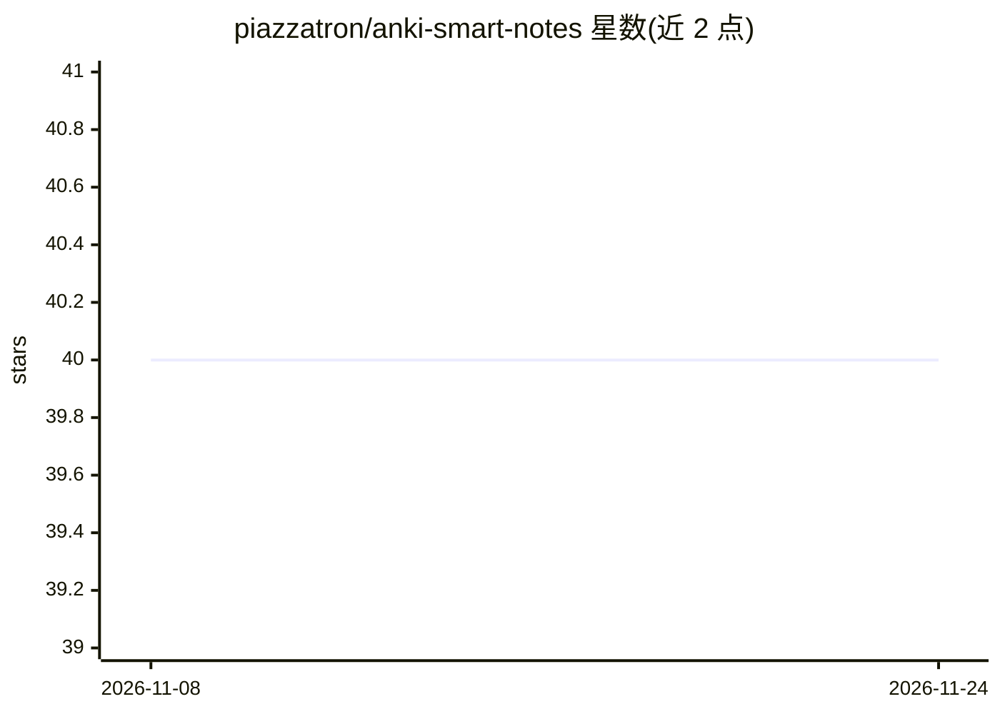

# piazzatron/anki-smart-notes

⭐ 40 · Python · GPL-3.0 · 推送 2026-11-23 · [GitHub](https://github.com/piazzatron/anki-smart-notes) · [官网](https://smart-notes.xyz) · 个人维护

**Anki 插件：用 AI 为卡片字段生成文本、例句、语音与图片**

Anki 间隔重复软件的付费插件（含免费试用）。用户可将笔记模板的任意字段设为 Smart Field，用自然语言描述需求（如生成自然例句），由 AI 填充文本、TTS 音频或图片，字段间可级联引用。支持单张手动、后台自动或整牌组（如万张笔记）批量处理。文本模型来自 OpenAI/Anthropic/Google，TTS 覆盖 80+ 语言 1,000+ 声音，需 Anki 2.1.50+（Qt6）。

## 筛选速览

| 维度 | 判定 | 备注 |
|---|---|---|
| AI 角色 | `ai-native` | 本体是模型或模型工具 |
| 许可风险 | `viral` | GPL-3.0 |
| 部署形态 | `library` | 以包/库形式分发 |
| 模型依赖 | locked-api |  |
| 硬件要求 | — | 无带数字的原话,不猜 |
| 安装摩擦 | `low` | 无编译、无系统依赖或容器化 |
| 成熟度 | — | 结构信号不足 |

## 能力要点

- 任意字段设为 Smart Field，自然语言描述后由 AI 填充
- AI 文本、TTS 音频、AI 生图与图片搜索多种输出
- 字段间级联：一个字段的句子可被下一字段朗读或配图
- 支持单张、后台自动与整牌组批量处理

## 适用场景

- 为语言学习卡片批量生成例句、读音和插图
- 给现有大牌组补充缺失字段内容
- 医学等学科卡片自动补充讲解文本与配图

## 场景标签

`语音合成` `AI 写作` `图像生成` · 领域:内容生成

## 证据(README 行号)

> L5: **Fill any field on your cards with AI text, audio and images.**
> L7: Smart Notes is an add-on for Anki, the spaced-repetition flashcard app. It turns any field on your note types into a

## 星数曲线

2026-11-08 40 → 2026-11-24 40（+0）

---
*卡片 v1 · prompt 1.4 · 生成 2026-11-18 · 置信度 mid · 依据 README sha `01348a60671b` · [字段定义](../../DATASET.md)*
