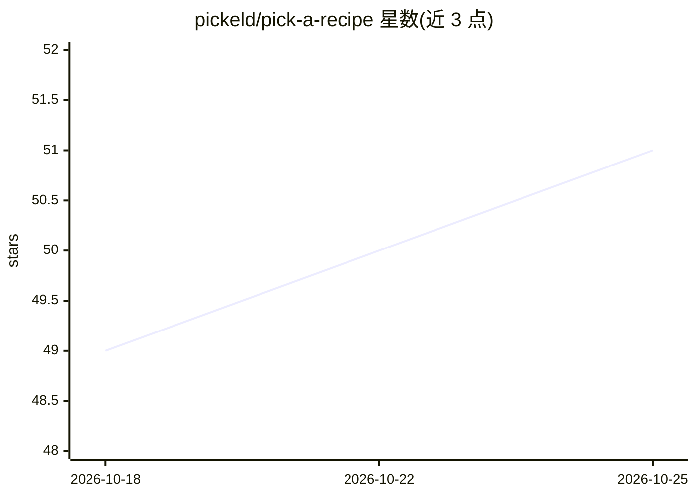

# pickeld/pick-a-recipe

⭐ 51 · Python · 推送 2026-10-19 · [GitHub](https://github.com/pickeld/pick-a-recipe) · 个人维护

**从 TikTok/YouTube/Instagram 视频提取食谱并导入自托管菜谱管理器**

Python/Flask 自托管应用：用 yt-dlp 下载 TikTok、YouTube、Instagram 等平台视频，faster-whisper 转录音频，视觉 LLM 提取画面中的食材与步骤文字，再由用户配置的 AI 供应商（OpenAI、Gemini、Anthropic 或任意 OpenAI 兼容端点）生成结构化食谱，上传至 Tandour 或 Mealie。营养估算基于内置成分表与 Open Food Facts 查询而非模型生成。提供 Web UI、用户认证（本地账户或 OIDC 单点登录）、PWA 与 Android 客户端、Docker 部署。需 Python 3.11+、FFmpeg 与 LLM API key。

## 筛选速览

| 维度 | 判定 | 备注 |
|---|---|---|
| AI 角色 | `ai-native` | 本体是模型或模型工具 |
| 许可风险 | `none` | — |
| 部署形态 | `self-host` | docker 或自建部署 |
| 模型依赖 | local-ok | 支持本地模型 |
| 硬件要求 | — | 无带数字的原话,不猜 |
| 安装摩擦 | `low` | 无编译、无系统依赖或容器化 |
| 成熟度 | — | 结构信号不足 |

## 能力要点

- yt-dlp 多平台下载 + faster-whisper 转录 + 视觉 LLM 提取画面文字
- 支持 OpenAI/Gemini/Anthropic 及任意 OpenAI 兼容端点（OpenRouter/Groq/本地 Ollama）
- 营养与份量估算基于内置成分表与 Open Food Facts，不由模型猜测
- 本地账户或任意 OIDC 供应商单点登录，Argon2id 密码存储

## 适用场景

- 把短视频里的菜谱自动收进我的 Tandoor/Mealie 菜谱库
- 批量整理收藏的烹饪视频为结构化食谱
- 自托管部署供家庭多人使用，含移动端 PWA/Android 访问

## 场景标签

 · 领域:生活/自托管应用

## 证据(README 行号)

> L17: 1. **Downloads videos** from TikTok, YouTube, Instagram, and other platforms using `yt-dlp`
> L20: 4. **Generates structured recipes** using an AI provider you configure (OpenAI, Google Gemini, Anthropic, or any Op
> L28: - 🤖 AI-powered recipe generation with structured ingredients

## 星数曲线

2026-10-18 49 → 2026-10-25 51（+2）

---
*卡片 v1 · prompt 1.4 · 生成 2026-10-24 · 置信度 high · 依据 README sha `d9217273db33` · [字段定义](../../DATASET.md)*
