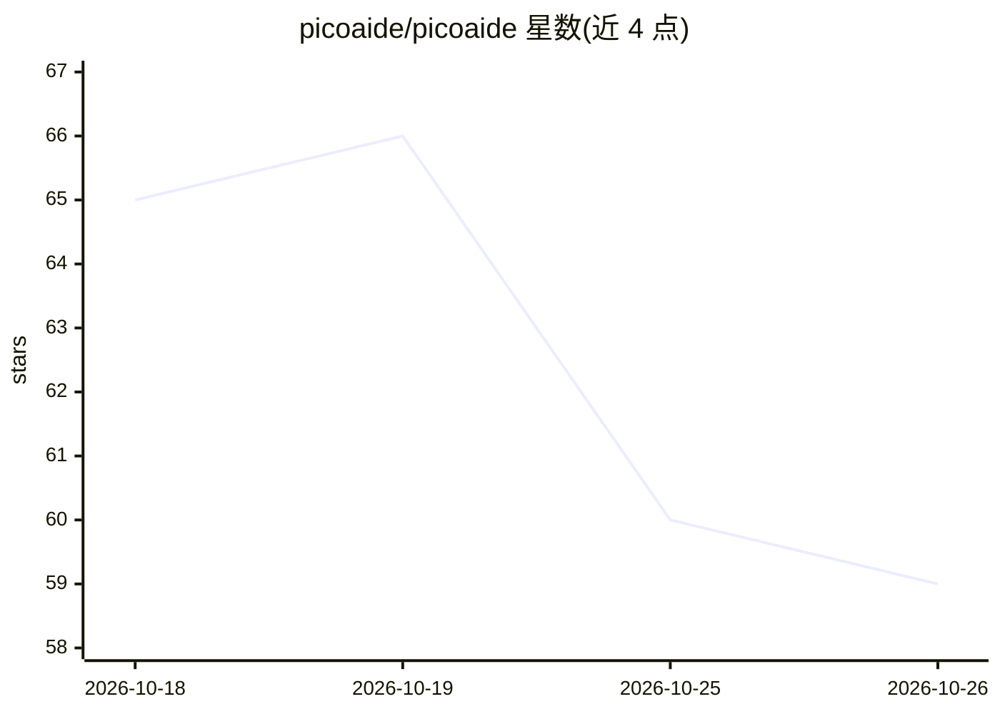

# picoaide/picoaide

⭐ 59 · Go · MIT · 推送 2026-07-28 · [GitHub](https://github.com/picoaide/picoaide) · [官网](https://www.picoaide.com) · 组织维护 · 中文 README

**私有化部署的企业 AI 代理管理平台：沙箱隔离、统一认证**

Go + Gin 实现的私有化 AI 代理管理平台，通过 overlayfs + network namespace 为每位员工分配独立 Linux 沙箱，配合 Chrome 浏览器扩展与 PyQt 桌面客户端让 AI 在授权范围内操作浏览器和桌面（MCP 三层中继，共 40 个工具）。认证可插拔，内置 Local / LDAP / OIDC；支持树形分组、Git 技能分发、Cron 定时 AI 任务、团队空间。不绑定任何大模型或 Agent 框架，沙箱内运行的 AI 软件由管理员决定。需 Linux 服务器（推荐 Ubuntu 22.04+ / Debian 12+）、root 与 systemd，不依赖 Docker。

## 筛选速览

| 维度 | 判定 | 备注 |
|---|---|---|
| AI 角色 | `ai-ecosystem` | LLM/agent 周边工具 |
| 许可风险 | `permissive` | MIT |
| 部署形态 | `None` |  |
| 模型依赖 | — | README 未给出锁定关系 |
| 硬件要求 | — | 无带数字的原话,不猜 |
| 安装摩擦 | `low` | 无编译、无系统依赖或容器化 |
| 成熟度 | — | 结构信号不足 |

## 能力要点

- overlayfs + network namespace 原生沙箱，iptables DROP 容器间隔离，不依赖 Docker
- 认证可插拔：Local / LDAP / OIDC，Provider 注册表模式
- MCP 三层中继：browser 19 工具 + computer 15 工具 + agent 平台工具与第三方 MCP 代理
- 技能从 Git 仓库分发，按组部署，含安装策略

## 适用场景

- 企业内为每位员工提供隔离的 AI 操作沙箱与统一登录
- 让 AI 在授权范围内操作浏览器与桌面完成办公任务
- 通过分组与技能策略集中管理员工的 AI 能力供给

## 场景标签

`浏览器自动化` `GUI 自动化` · 领域:效率与自动化

## 证据(README 行号)

> L5: PicoAide 是一个私有化部署的 AI 代理管理平台。通过 overlayfs + network namespace 为每位员工分配独立的 AI 沙箱，配合浏览器扩展和桌面客户端让 AI 在授权范围内操作真实环境。认证可插拔（
> L15: PicoAide 不绑定任何大模型，不限定任何 Agent 框架。用户沙箱内跑什么 AI 软件由管理员决定，PicoAide 只负责供给和连接。

## 星数曲线

2026-10-18 65 → 2026-10-26 59（-6）

---
*卡片 v1 · prompt 1.4 · 生成 2026-10-24 · 置信度 high · 依据 README sha `38e34d765919` · [字段定义](../../DATASET.md)*
