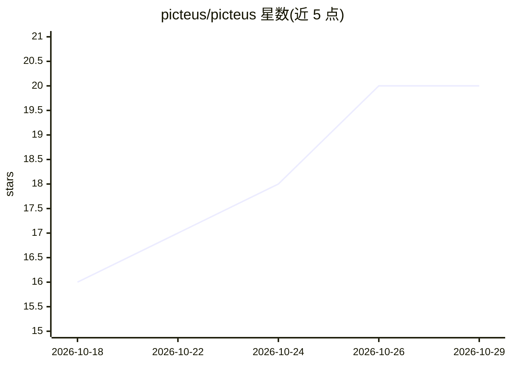

# picteus/picteus

⭐ 20 · TypeScript · AGPL-3.0 · 推送 2026-10-26 · [GitHub](https://github.com/picteus/picteus) · [官网](https://www.picteus.com) · 组织维护

**本地优先的 AI 图像资产编目与编排框架（桌面+服务端）**

Picteus 是本地优先的桌面与服务端平台，用于编目、检查、标注和编排 AI 生成的图像资产，连接本地与远程机器学习运行时。内置集成本地推理引擎（ComfyUI、Automatic1111、Ollama、Stable Diffusion 放大器）与云服务（Anthropic Claude、Gemini、Midjourney、Replicate），支持 C2PA 溯源、向量相似检索（SQLite + Chroma DB），并通过 MCP 向 AI agent 暴露工具。桌面版提供 Windows x64 与 macOS ARM64 预打包安装包，也提供 Docker 镜像与 OpenAPI 3.1 REST API；当前处于 beta 阶段。

## 筛选速览

| 维度 | 判定 | 备注 |
|---|---|---|
| AI 角色 | `ai-ecosystem` | LLM/agent 周边工具 |
| 许可风险 | `viral` | AGPL-3.0 |
| 部署形态 | `desktop` | 安装包/桌面程序 |
| 模型依赖 | local-ok | 支持本地模型 |
| 硬件要求 | — | 无带数字的原话,不猜 |
| 安装摩擦 | `low` | 无编译、无系统依赖或容器化 |
| 成熟度 | `idea` | |

## 能力要点

- 连接 ComfyUI/Automatic1111/Ollama 本地引擎与 Claude/Gemini/Midjourney 等云服务
- 图像索引、分面检索、向量相似检索与标签管理
- MCP server 集成，向 AI agent 暴露工具与图像搜索
- 桌面安装包（Windows x64/macOS ARM64）与 Docker 容器双分发，Python/TypeScript 扩展 SDK

## 适用场景

- 为 AI 生成图像建立本地可检索的资产库并管理元数据
- 在统一界面中编排本地与云端生成/推理工作流
- 通过 MCP 让 AI agent 调用图像工具与检索能力
- 编写自定义扩展接入新的模型或服务

## 场景标签

`工作流自动化` `图像生成` `语义搜索` · 领域:效率与自动化

## 证据(README 行号)

> L24: Picteus is a local-first desktop and server platform designed to catalog, inspect, annotate, and orchestrate AI-gen
> L64: - **Local generation and inference**: ComfyUI, Automatic1111, Ollama, and local Stable Diffusion upscalers ;
> L67: - **Agentic interoperability**: Model Context Protocol (MCP) server integration, exposing Picteus tools and image s

## 星数曲线

2026-10-18 16 → 2026-10-29 20（+4）

---
*卡片 v1 · prompt 1.4 · 生成 2026-10-28 · 置信度 high · 依据 README sha `48fe70a98dd6` · [字段定义](../../DATASET.md)*
