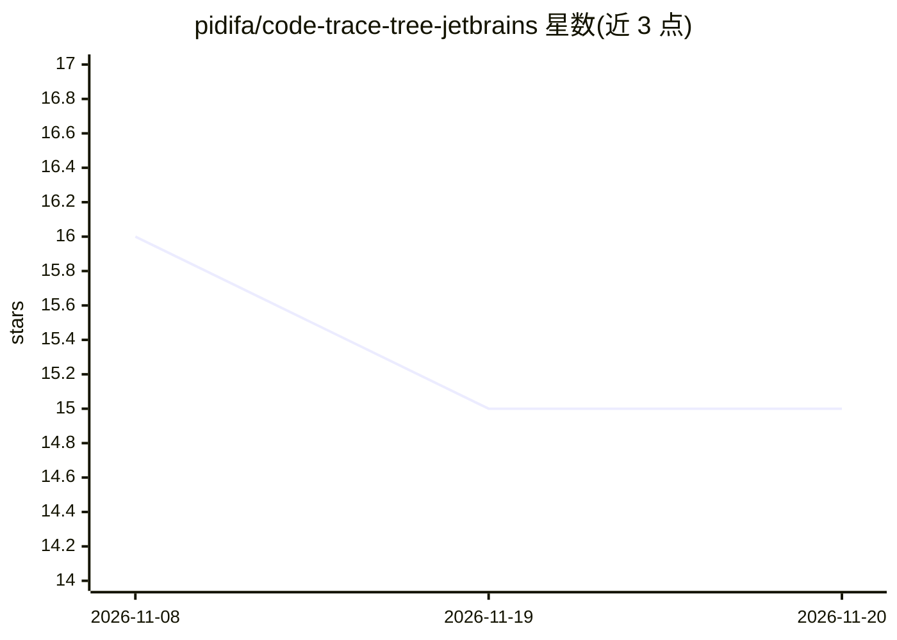

# pidifa/code-trace-tree-jetbrains

⭐ 15 · Kotlin · MIT · 推送 2026-11-07 · [GitHub](https://github.com/pidifa/code-trace-tree-jetbrains) · 个人维护

**JetBrains 代码追踪插件：以树形追踪点记录代码流程，可配合 AI agent**

JetBrains（兼 VS Code 描述）IDE 插件，以嵌套追踪点（行、文件、目录）构建并展示代码工作流：从编辑器右键菜单创建/移动/更新追踪点，双击跳回源码，支持多级追踪、Profile 切换、失效点清理与导入导出。可通过 Agent Skill 与 Claude Code、Cursor、Gemini CLI 等 coding agent 配合，让 agent 搜索、增删、重绑追踪点并通知 IDE 刷新；插件本身不内置 agent，需单独安装 agent 与 Python 3 后安装 skill。

## 筛选速览

| 维度 | 判定 | 备注 |
|---|---|---|
| AI 角色 | `ai-enhanced` | 去掉 AI 部分产品仍成立 |
| 许可风险 | `permissive` | MIT |
| 部署形态 | `library` | 以包/库形式分发 |
| 模型依赖 | — | README 未给出锁定关系 |
| 硬件要求 | — | 无带数字的原话,不猜 |
| 安装摩擦 | `medium` | 含编译或系统依赖之一 |
| 成熟度 | — | 结构信号不足 |

## 能力要点

- 行/文件/目录三级别追踪点树，双击跳转源码
- Agent Skill 使 coding agent 可增删、重绑追踪点并同步 IDE
- 追踪数据存于全局共享目录，按内容出现次数在代码移动后重新定位
- 支持多 Profile、失效点清理与导入导出

## 适用场景

- 在 IDE 里梳理并留存方法调用路径，随时跳回源码
- 让 coding agent 沿调用路径自动生成或维护追踪点
- 跨会话保存对陌生代码库的理解线索

## 场景标签

 · 领域:开发工具/IDE 插件

## 证据(README 行号)

> L14:  Trace code in a tree structure with AI support. Build and display code workflows as nested trace points
> L18:  Use it manually or pair it with the Agent Skill so coding agents such as Claude Code, Cursor, or Gemini CLI
> L20:  This plugin does not include an AI agent; install your preferred agent separately, then

## 星数曲线

2026-11-08 16 → 2026-11-20 15（-1）

---
*卡片 v1 · prompt 1.4 · 生成 2026-11-18 · 置信度 mid · 依据 README sha `5639ff6d56f5` · [字段定义](../../DATASET.md)*
