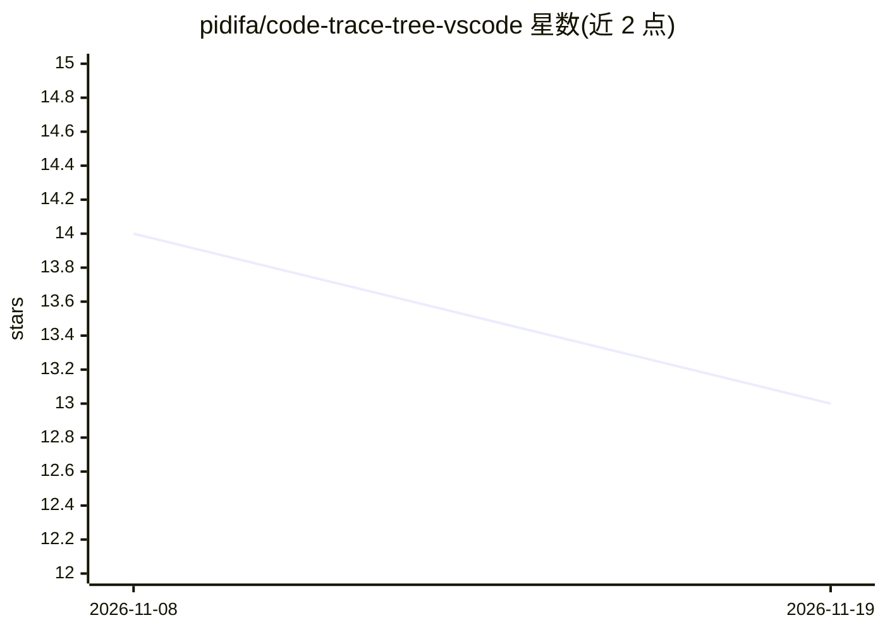

# pidifa/code-trace-tree-vscode

⭐ 13 · TypeScript · MIT · 推送 2026-11-08 · [GitHub](https://github.com/pidifa/code-trace-tree-vscode) · 个人维护

**带 AI agent 技能的 VS Code/JetBrains 代码追踪树插件**

VS Code/JetBrains 插件，以嵌套树结构记录代码工作流：可对行、文件、目录创建追踪点，双击跳回源码，支持多级追踪、拖拽调整父节点、导入导出。AI 部分为可选的 Agent Skill：安装到 Claude Code、Cursor、GitHub Copilot、Codex、Gemini CLI 等 coding agent 的技能目录后，agent 可搜索、新增、移动、重绑追踪点并通知 IDE 刷新；插件本身不含 AI agent，需另装 Python 3 供技能脚本使用。去掉 AI 功能后追踪功能仍独立可用。

## 筛选速览

| 维度 | 判定 | 备注 |
|---|---|---|
| AI 角色 | `ai-enhanced` | 去掉 AI 部分产品仍成立 |
| 许可风险 | `permissive` | MIT |
| 部署形态 | `library` | 以包/库形式分发 |
| 模型依赖 | — | README 未给出锁定关系 |
| 硬件要求 | — | 无带数字的原话,不猜 |
| 安装摩擦 | `low` | 无编译、无系统依赖或容器化 |
| 成熟度 | — | 结构信号不足 |

## 能力要点

- 行/文件/目录级追踪点，双击跳转源码，多级追踪
- Agent Skill 支持 Claude Code、Cursor、Codex、Gemini CLI 等 agent 操作追踪点
- 追踪点绑定行内容，源码编辑后可重绑位置
- 追踪数据按操作系统存储于全局共享文件夹

## 适用场景

- 在阅读大型代码时按调用路径建立可跳转的追踪树
- 让 coding agent 在对话中自动生成或维护追踪点
- 团队导入导出追踪树共享代码理解成果

## 场景标签

 · 领域:开发工具/IDE 插件

## 证据(README 行号)

> L19:  Trace code in a tree structure with AI support. Build and display code workflows as nested trace points
> L25:  This extension does not include an AI agent; install your preferred agent separately, then
> L59:  This extension does not ship an AI agent. Install your preferred coding agent, then install

## 星数曲线

2026-11-08 14 → 2026-11-19 13（-1）

---
*卡片 v1 · prompt 1.4 · 生成 2026-11-18 · 置信度 mid · 依据 README sha `71928f5bcda1` · [字段定义](../../DATASET.md)*
