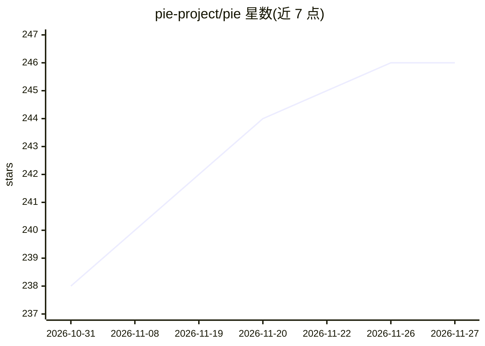

# pie-project/pie

⭐ 246 · Rust · Apache-2.0 · 推送 2026-11-26 · [GitHub](https://github.com/pie-project/pie) · [官网](https://pie-project.org) · 组织维护

**模型推理服务引擎：以可编程 inferlet 方式驱动模型**

Pie 是一个模型服务系统，运行 WebAssembly 程序 inferlet，紧邻模型执行，每个 inferlet 驱动前向传播、持有状态，并把自定义 epilogue 编译为 GPU kernel，解码、采样、缓存与 agent 循环可用 Python/JavaScript/Rust 编写。模型以 Poem 语言编写，覆盖语言、视觉、图像、视频。整体发布为单个约 60 MB 二进制，不含 Python/PyTorch 运行时，支持 CUDA、ROCm、Metal、Vulkan、XLA、WebGPU 后端，并可兼容 OpenAI/Anthropic/Gemini API。

## 筛选速览

| 维度 | 判定 | 备注 |
|---|---|---|
| AI 角色 | `ai-ecosystem` | LLM/agent 周边工具 |
| 许可风险 | `permissive` | Apache-2.0 |
| 部署形态 | `None` |  |
| 模型依赖 | — | README 未给出锁定关系 |
| 硬件要求 | — | 无带数字的原话,不猜 |
| 安装摩擦 | `high` | 编译与系统依赖俱全 |
| 成熟度 | — | 结构信号不足 |

## 能力要点

- inferlet 以 WebAssembly 形式紧邻模型运行，解码/采样/缓存按应用编写
- 单二进制约 60 MB，无 Python 或 PyTorch 运行时
- 兼容 OpenAI、Anthropic、Gemini API 于同一端口
- WorkingSet 状态句柄可 fork 与跨程序传递

## 适用场景

- 部署本地推理服务并用 OpenAI 兼容客户端调用
- 为应用编写自定义解码、采样与 agent 循环逻辑
- 在浏览器 Playground 中运行推理

## 场景标签

`推理引擎` · 领域:训练与推理

## 证据(README 行号)

> L7: Pie runs WebAssembly programs—*inferlets*—directly next to the
> L12: Models are programs too, written in Poem across language, vision,
> L68: `pie serve` also speaks the

## 星数曲线

2026-10-31 238 → 2026-11-27 246（+8）

---
*卡片 v1 · prompt 1.4 · 生成 2026-11-25 · 置信度 high · 依据 README sha `5b5341ebf8e5` · [字段定义](../../DATASET.md)*
