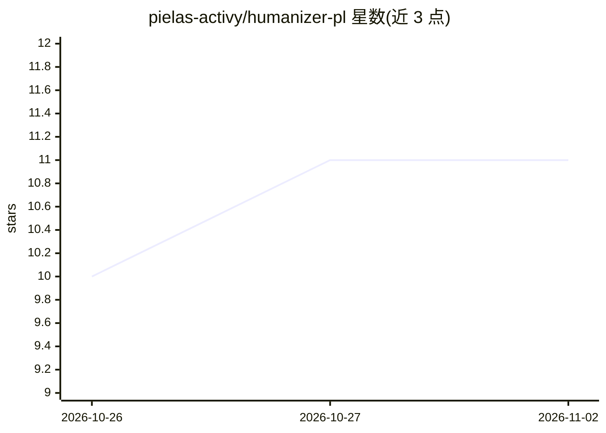

# pielas-activy/humanizer-pl

⭐ 11 · Python · NOASSERTION · 推送 2026-06-15 · [GitHub](https://github.com/pielas-activy/humanizer-pl) · 个人维护

**波兰语+英语双语的去 AI 痕迹改写技能，供 Claude Code 使用**

blader/humanizer 的 fork，作为 Claude Code/Cowork 的 skill 安装：检测文本语言（PL/EN）后加载对应模式，移除 AI 写作痕迹（长破折号、三段式、波兰语特有的仿译与断句等），保留事实与作者语声。可选维护个人术语表，避免专业词汇被改写。含实验性 Bielik（本地波兰语 LLM，经 Ollama）审阅模式及自动安装脚本，附 6 条二元断言的评测脚本。MIT 许可。

## 筛选速览

| 维度 | 判定 | 备注 |
|---|---|---|
| AI 角色 | `ai-ecosystem` | LLM/agent 周边工具 |
| 许可风险 | `none` | NOASSERTION |
| 部署形态 | `None` |  |
| 模型依赖 | local-ok | 支持本地模型 |
| 硬件要求 | — | 无带数字的原话,不猜 |
| 安装摩擦 | `low` | 无编译、无系统依赖或容器化 |
| 成熟度 | — | 结构信号不足 |

## 能力要点

- PL/EN 自动语言检测并加载对应改写模式
- 针对波兰语的仿译扫描（反向翻译测试）与断句合并
- 可选本地术语表（per-user、本地存储），保护专业词汇
- 可选 Bielik-11B（Ollama）本地模型审阅模式，附自动安装脚本

## 适用场景

- 我在 Claude Code 里改写波兰语或英语文本，去掉 AI 写作痕迹
- 保留我的行业术语不被误改或误译
- 生成改动对照的 HTML 报告查看修改点

## 场景标签

`AI 写作` · 领域:内容生成

## 证据(README 行号)

> L3: Dwujęzyczny (PL + EN) skill do Claude Code / Cowork, który usuwa oznaki pisania AI z tekstu,
> L19: Skopiuj do katalogu skilli Claude Code:
> L106: W Claude Code: `/humanizer-pl` albo "zhumanizuj ten post / wywal AI-slop z tego maila".

## 星数曲线

2026-10-26 10 → 2026-11-02 11（+1）

---
*卡片 v1 · prompt 1.4 · 生成 2026-11-01 · 置信度 high · 依据 README sha `49dfcead241e` · [字段定义](../../DATASET.md)*
