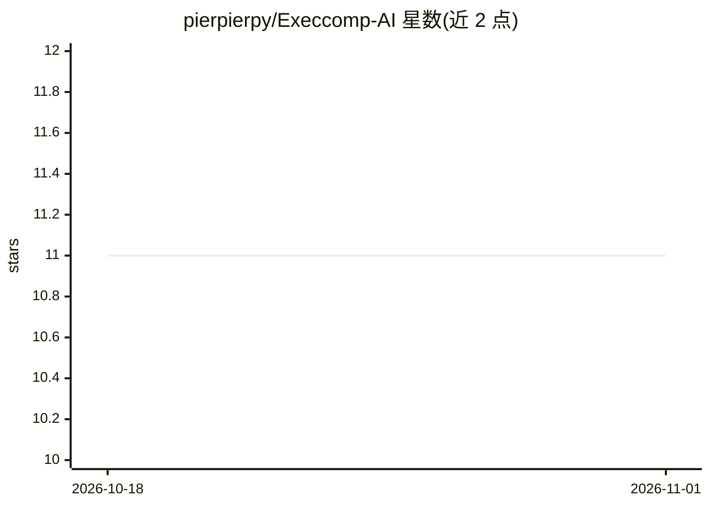

# pierpierpy/Execcomp-AI

⭐ 11 · Jupyter Notebook · Apache-2.0 · 推送 2026-02-04 · [GitHub](https://github.com/pierpierpy/Execcomp-AI) · 个人维护

**用 VLM 从 SEC 代理声明批量抽取高管薪酬数据的流水线**

面向学术研究与公司治理分析的数据抽取管线：处理 2005-2022 年 10 万+ 份 SEC DEF 14A 代理声明，用 MinerU 做表格抽取、Qwen3-VL-32B 做表格分类与结构化抽取、微调的 Qwen3-VL-4B 过滤误报，输出结构化 JSON 并推送 HuggingFace 数据集。管线通过 pipeline_tracker.json 记录各阶段状态，支持断点续跑、失败文档修复与阈值分析。需 Python 3.10+、wkhtmltopdf，默认需 40GB+ VRAM GPU（仅 MinerU 必须本地 GPU，分类/抽取可换 OpenAI 兼容云端 API）。项目自标为进行中（Work in Progress）。

## 筛选速览

| 维度 | 判定 | 备注 |
|---|---|---|
| AI 角色 | `ai-native` | 本体是模型或模型工具 |
| 许可风险 | `permissive` | Apache-2.0 |
| 部署形态 | `library` | 以包/库形式分发 |
| 模型依赖 | local-ok | 支持本地模型 |
| 硬件要求 | — | 无带数字的原话,不猜 |
| 安装摩擦 | `medium` | 含编译或系统依赖之一 |
| 成熟度 | `idea` | |

## 能力要点

- MinerU + Qwen3-VL-32B 分类/抽取 + 微调 Qwen3-VL-4B 误报过滤的三段式管线
- 处理 100K+ 份 SEC DEF 14A（2005-2022），含 2006 年前后格式差异的列名映射
- pipeline_tracker.json 中央状态跟踪，支持断点续跑与失败文档重处理
- 分类/抽取走 OpenAI 兼容 API，可替换本地 vLLM 为云端模型

## 适用场景

- 批量构建高管薪酬研究数据集替代付费的 ExecuComp
- 公司治理与市场研究分析薪酬数据
- 从原始 SEC 申报文件生成结构化 JSON 数据

## 场景标签

`文档解析` `科研工具` · 领域:知识与检索

## 证据(README 行号)

> L3: AI-powered pipeline to extract executive compensation data from SEC DEF 14A proxy statements.
> L34: Extracts **Summary Compensation Tables** from 100K+ SEC filings (2005-2022) using:
> L36: - **Qwen3-VL-32B** for classification and structured extraction

## 星数曲线

2026-10-18 11 → 2026-11-01 11（+0）

---
*卡片 v1 · prompt 1.4 · 生成 2026-11-01 · 置信度 high · 依据 README sha `ca050100f701` · [字段定义](../../DATASET.md)*
