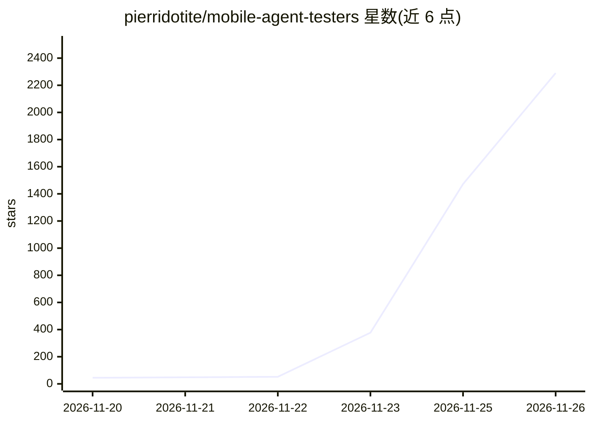

# pierridotite/mobile-agent-testers

⭐ 2,290 · Python · MIT · 推送 2026-11-25 · [GitHub](https://github.com/pierridotite/mobile-agent-testers) · 个人维护

**在 GitHub 免费运行器上并行运行 20 个 AI 测试员找出 App 缺陷**

一个 Claude Code 插件/工作流模板：在 GitHub Actions 的免费 runner 上，为每个 AI 测试员分配一台 iOS Simulator 或 Android 模拟器，以不同 persona（语言、字号、屏幕方向等）探索目标应用或复测指定功能，输出带编号截图的缺陷报告。支持探索测试、端到端走查、bug 复现、改进建议与双版本对比五种用途；面向 Flutter、React Native、Expo、原生 Kotlin/Swift 等框架的 App。模型费用由用户的 Claude 订阅或 API key 承担，也可接入 Anthropic 兼容 API 换用更低价模型；公开仓库 runner 免费，私有仓库 macOS 分钟有计费倍率。

## 筛选速览

| 维度 | 判定 | 备注 |
|---|---|---|
| AI 角色 | `ai-native` | 本体是模型或模型工具 |
| 许可风险 | `permissive` | MIT |
| 部署形态 | `None` |  |
| 模型依赖 | locked-api |  |
| 硬件要求 | — | 无带数字的原话,不猜 |
| 安装摩擦 | `low` | 无编译、无系统依赖或容器化 |
| 成熟度 | — | 结构信号不足 |

## 能力要点

- 每次运行最多 20 个 AI 测试员并行，覆盖 14 种语言与多尺寸设备 persona
- 五种运行模式：新用户探索、单功能端到端、bug 复现、改进报告、双版本对比
- 输出带截图的缺陷报告并自动去重汇总为 SUMMARY.md
- 支持 Claude Haiku 或任何 Anthropic 兼容 API（OpenRouter/DeepSeek/Kimi 等）降低成本

## 适用场景

- 发布前用不同设备与语言 persona 探索式找出崩溃流程和布局缺陷
- 按无障碍配置（大字号、RTL）复测 App 的翻译与可访问性问题
- 在两个分支/构建上用同一组 persona 对比验证改动效果
- 给一份 bug 报告让多台手机并行验证能否复现

## 场景标签

 · 领域:软件测试/开发者工具

## 证据(README 行号)

> L14: No test scripts to write. Each tester is a Claude Code agent with its own iOS
> L36: One use per run, set with the inputs of Test your own app.
> L43: - **Use a cheaper model**: Claude Haiku, or any Anthropic-compatible API (OpenRouter, DeepSeek, Kimi, GLM, MiniMax,

## 星数曲线

2026-11-20 45 → 2026-11-26 2,290（+2,245）

---
*卡片 v1 · prompt 1.4 · 生成 2026-11-24 · 置信度 high · 依据 README sha `dd2f5174c0f9` · [字段定义](../../DATASET.md)*
