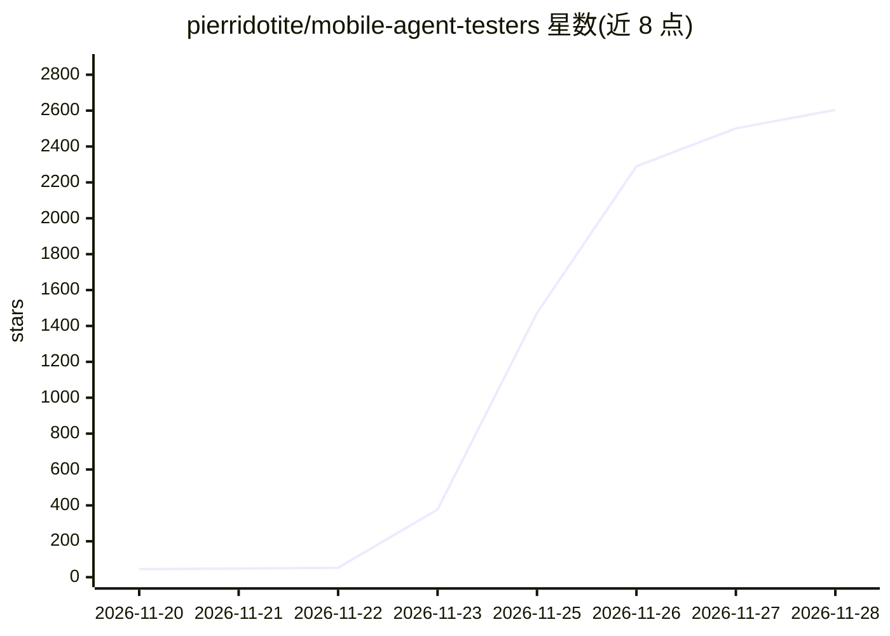

# pierridotite/mobile-agent-testers

⭐ 2,604 · Python · MIT · 推送 2026-11-27 · [GitHub](https://github.com/pierridotite/mobile-agent-testers) · 个人维护 · 中文 README

**在 GitHub 免费运行器上并行跑 20 个 AI 测试员测手机 App**

以 Claude Code agent 形式在 GitHub Actions 上运行 20 个 AI 测试员，各占一台 iOS Simulator 或 Android 模拟器，扮演不同 persona（语言、字号、设备）探索应用并生成带截图的 bug 报告。支持新用户体验探索、单功能端到端走查、bug 复现、改进报告、双版本对比、手机浏览器测网站六种用途。模板仓库方式安装，公共仓库运行器免费，模型费用按 Claude 订阅或 API key 计。找到的 bug 路径可编译为 Maestro 流程用于回归重放（仅 Android）。

## 筛选速览

| 维度 | 判定 | 备注 |
|---|---|---|
| AI 角色 | `ai-native` | 本体是模型或模型工具 |
| 许可风险 | `permissive` | MIT |
| 部署形态 | `None` |  |
| 模型依赖 | locked-api |  |
| 硬件要求 | — | 无带数字的原话,不猜 |
| 安装摩擦 | `low` | 无编译、无系统依赖或容器化 |
| 成熟度 | `idea` | |

## 能力要点

- 每个测试员是独立 Claude Code agent，绑定一台模拟器/仿真器并行运行
- 六种测试用途：新用户探索、端到端走查、bug 复现、改进报告、版本对比、网页测试
- bug 路径以 Explore-Compile-Replay 格式编译为 Maestro 流程并重放回归
- 屏幕地图仪表盘：每台设备路径、点击热图、可在图上添加检查点

## 适用场景

- 发布前让 AI persona 以新用户身份探索 App，找出流程与布局 bug
- 在多语言、大字号、平板等设备形态下检查无障碍与翻译问题
- 复现用户 bug 报告并把修复后的路径固化为回归测试
- 对比两个分支/构建版本的目标达成度与问题差异

## 场景标签

`编码 Agent` `GUI 自动化` · 领域:效率与自动化

## 证据(README 行号)

> L23: No test scripts to write. Each tester is a Claude Code agent with its own iOS
> L59: Each persona explores your app like a new user and reports what gets in the way, with numbered screenshots. A run c
> L72: Any Anthropic-compatible model works, from Claude Haiku to OpenRouter, DeepSeek, Kimi, GLM, MiniMax or Qwen; findin

## 星数曲线

2026-11-20 45 → 2026-11-28 2,604（+2,559）

---
*卡片 v1 · prompt 1.4 · 生成 2026-11-28 · 置信度 high · 依据 README sha `d73406a9abcb` · [字段定义](../../DATASET.md)*
