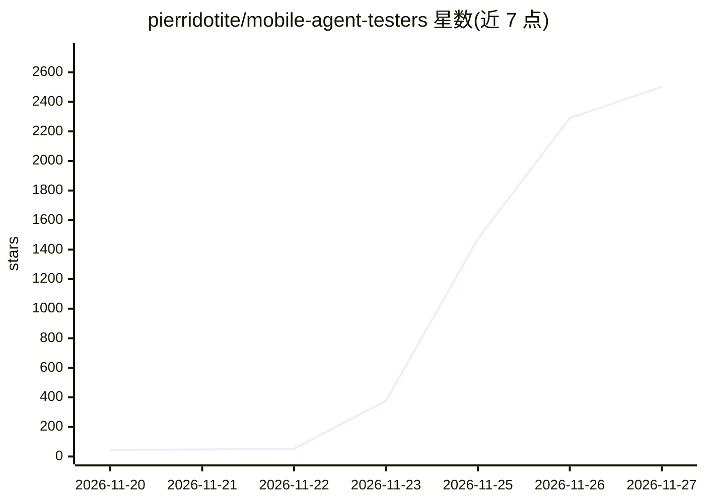

# pierridotite/mobile-agent-testers

⭐ 2,501 · Python · MIT · 推送 2026-11-26 · [GitHub](https://github.com/pierridotite/mobile-agent-testers) · 个人维护

**用 20 个 Claude Code agent 在模拟器上并行找移动 App 缺陷**

以 GitHub Actions 模板形式分发的移动端自动化测试工具：每个 Claude Code agent 绑定一台 iOS Simulator 或 Android 模拟器，按角色设定（不同语言、字号、设备）探索应用，产出带截图的缺陷报告与仪表盘。支持六种用途：新人视角探索、单功能端到端走查、复现缺陷报告、改进报告、双版本对比、手机浏览器测网站。运行于公共仓库免费 runner，模型费用按 Claude 订阅或 API key 计费；Android 路径可经 Explore-Compile-Replay 编译为 Maestro 流程做无模型回归。

## 筛选速览

| 维度 | 判定 | 备注 |
|---|---|---|
| AI 角色 | `ai-native` | 本体是模型或模型工具 |
| 许可风险 | `permissive` | MIT |
| 部署形态 | `None` |  |
| 模型依赖 | locked-api |  |
| 硬件要求 | — | 无带数字的原话,不猜 |
| 安装摩擦 | `low` | 无编译、无系统依赖或容器化 |
| 成熟度 | `idea` | |

## 能力要点

- 20 个 agent 在 GitHub Actions 免费 runner 上并行测试，各有独立模拟器
- 六种用途：探索、端到端走查、复现缺陷、改进报告、版本对比、测网站
- 发现的缺陷路径可编译为 Maestro 流程做无模型回归重放（Android）
- 支持任意 Anthropic 兼容模型，含 OpenRouter/DeepSeek/Kimi/Qwen 等

## 适用场景

- 发布前让多个角色账号探索 App，收集可用性与翻译缺陷
- 复现用户缺陷报告并附截图证据
- 对比两个分支/构建的可用性表现
- 在手机浏览器环境测试网站

## 场景标签

`编码 Agent` `GUI 自动化` `浏览器自动化` `模型评测` · 领域:效率与自动化

## 证据(README 行号)

> L23: No test scripts to write. Each tester is a Claude Code agent with its own iOS
> L59: Each persona explores your app like a new user and reports what gets in the way, with numbered screenshots. A run c
> L72: Any Anthropic-compatible model works, from Claude Haiku to OpenRouter, DeepSeek, Kimi, GLM, MiniMax or Qwen; findin

## 星数曲线

2026-11-20 45 → 2026-11-27 2,501（+2,456）

---
*卡片 v1 · prompt 1.4 · 生成 2026-11-27 · 置信度 high · 依据 README sha `80c570489a7f` · [字段定义](../../DATASET.md)*
