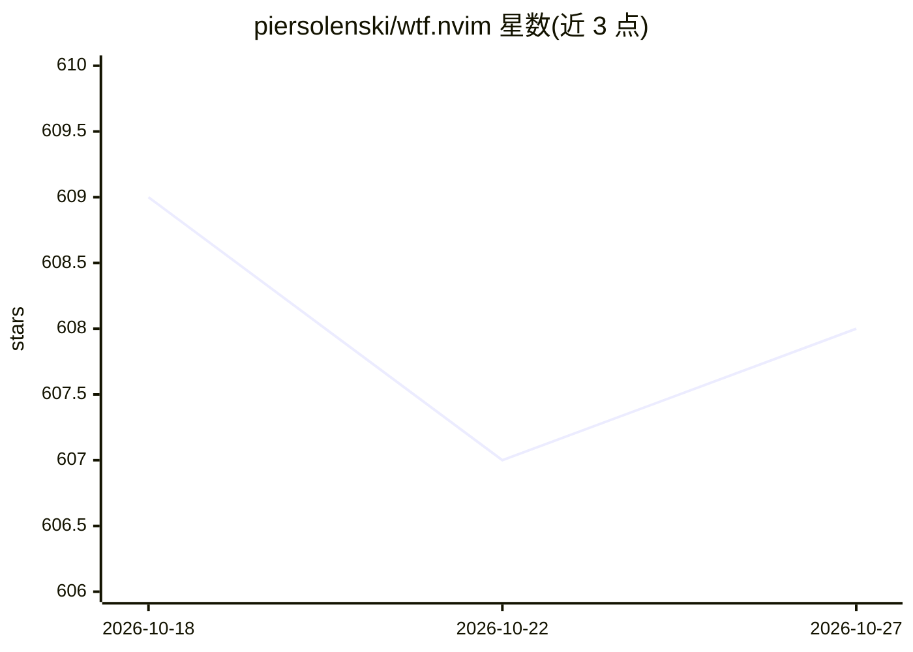

# piersolenski/wtf.nvim

⭐ 608 · Lua · WTFPL · 推送 2026-06-02 · [GitHub](https://github.com/piersolenski/wtf.nvim) · 个人维护

**Neovim 插件：用 AI 解释与修复 LSP 诊断信息**

面向 Neovim 用户的诊断调试插件：将当前行的 LSP 诊断信息连同上下文（代码、文件类型、严重级别）发送到可配置的 AI 提供商（Anthropic、Copilot、DeepSeek、Gemini、Grok、Ollama、OpenAI），返回解释或直接尝试修复；也可调用 Google、Stack Overflow 等搜索引擎检索诊断信息，并提供历史会话快速查看、grep 与剪贴板复制等命令。通过 lazy.nvim / packer.nvim 安装，支持 Telescope、Snacks.nvim、FZF-lua 三种 picker。

## 筛选速览

| 维度 | 判定 | 备注 |
|---|---|---|
| AI 角色 | `ai-enhanced` | 去掉 AI 部分产品仍成立 |
| 许可风险 | `viral` | WTFPL |
| 部署形态 | `None` |  |
| 模型依赖 | local-ok | 支持本地模型 |
| 硬件要求 | — | 无带数字的原话,不猜 |
| 安装摩擦 | `low` | 无编译、无系统依赖或容器化 |
| 成熟度 | — | 结构信号不足 |

## 能力要点

- 诊断信息+代码上下文发送给 7 家 AI 提供商，生成解释或自动修复
- :WtfSearch 直接从 Neovim 打开 Google/Stack Overflow 等搜索诊断
- 支持 Telescope / Snacks.nvim / FZF-lua 三种 picker 与 lualine 状态组件
- 会话历史可通过 quickfix 列表与 grep 回查

## 适用场景

- 在编辑器内直接理解报错原因而不必切换到浏览器
- 让 AI 按额外指令（如命名规范）直接修改问题代码
- 回查和检索过往的 AI 调试对话记录

## 场景标签

`代码生成` · 领域:编码与开发

## 证据(README 行号)

> L5: A Neovim plugin to help you work out _what the fudge_ that diagnostic means **and** how to fix it!
> L13: Use the power of AI to provide you with explanations _and_ solutions for how to fix diagnostics, custom tailored to

## 星数曲线

2026-10-18 609 → 2026-10-27 608（-1）

---
*卡片 v1 · prompt 1.4 · 生成 2026-10-21 · 置信度 high · 依据 README sha `1ac4e88f7849` · [字段定义](../../DATASET.md)*
