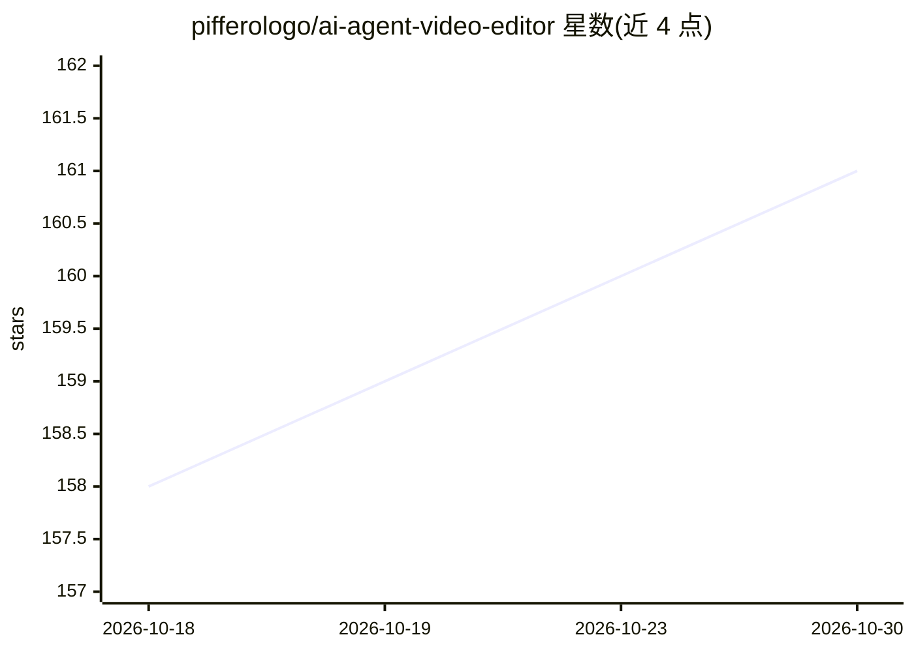

# pifferologo/ai-agent-video-editor

⭐ 161 · TypeScript · MIT · 推送 2026-09-14 · [GitHub](https://github.com/pifferologo/ai-agent-video-editor) · 组织维护

**供 AI agent 使用的对话式视频剪辑 CLI 工具**

面向 AI agent 的 Node.js 类型化 CLI：用 ElevenLabs Scribe 对原始素材做词级转录（含说话人分离与音频事件），按静音感知做短语打包生成面向 LLM token 效率优化的 markdown，agent 据此提出剪辑策略、写入 edl.json，再经 ffmpeg 渲染出 final.mp4（含调色、30ms 音频淡入淡出、HDR tone-map、字幕烧录）。LLM 不直接看视频帧，仅读取打包转录文本并按需请求时间轴 PNG。可选 Redis 缓存转录，需 Node.js 18+、ffmpeg/ffprobe 与 ElevenLabs API key。

## 筛选速览

| 维度 | 判定 | 备注 |
|---|---|---|
| AI 角色 | `ai-ecosystem` | LLM/agent 周边工具 |
| 许可风险 | `permissive` | MIT |
| 部署形态 | `library` | 以包/库形式分发 |
| 模型依赖 | — | README 未给出锁定关系 |
| 硬件要求 | — | 无带数字的原话,不猜 |
| 安装摩擦 | `medium` | 含编译或系统依赖之一 |
| 成熟度 | — | 结构信号不足 |

## 能力要点

- ElevenLabs Scribe 词级转录，含说话人分离、音频事件与逐文件缓存
- 静音感知的短语打包，约每小时素材压缩至 12 KB 供 LLM 阅读
- EDL 渲染管线：逐段调色、30 ms 音频淡变、HDR tone-map、字幕最后烧录
- 时间轴 filmstrip+波形 PNG 供剪辑点下钻分析

## 适用场景

- 让 AI agent 基于转录文本自动生成剪辑方案并渲染成片
- 批量转录原始素材并构建可复用的剪辑工作目录
- 长素材剪辑时通过按需视觉合图降低 LLM 上下文消耗

## 场景标签

`语音识别` `图像视频处理` · 领域:感知与多模态

## 证据(README 行号)

> L3: Conversation-driven video editing for AI agents. Transcribe raw footage with ElevenLabs Scribe, pack phrase-level tr
> L7: video-use gives an LLM structured text (word-level transcripts) plus on-demand visual composites instead of dumping 

## 星数曲线

2026-10-18 158 → 2026-10-30 161（+3）

---
*卡片 v1 · prompt 1.4 · 生成 2026-10-22 · 置信度 high · 依据 README sha `252e2a1f67cf` · [字段定义](../../DATASET.md)*
