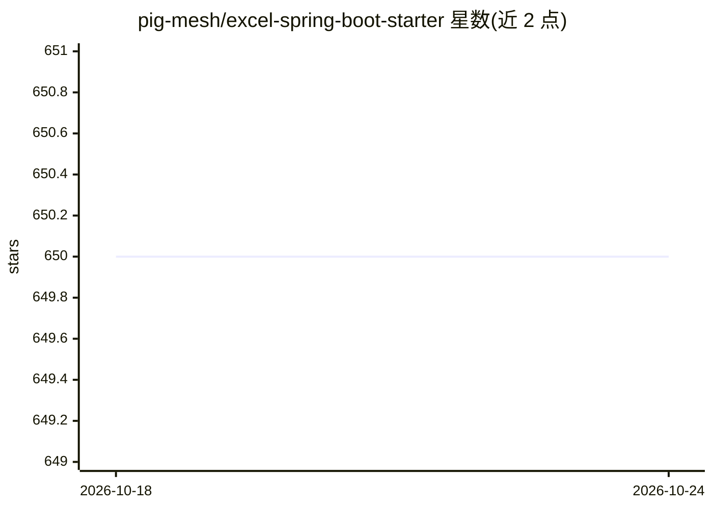

# pig-mesh/excel-spring-boot-starter

⭐ 650 · Java · Apache-2.0 · 推送 2026-07-10 · [GitHub](https://github.com/pig-mesh/excel-spring-boot-starter) · [官网](https://www.yuque.com/pig4cloud/excel) · 组织维护 · 中文 README

**给 Spring Boot 开发者的 Excel 导入导出封装库**

基于 Apache FESOD（原 EasyExcel/FastExcel 路线的低内存 Excel 读写库）封装的 Spring Boot Starter：通过注解配置 Excel 导入导出格式，提供 API 减少手动处理工作量，适配 Spring Boot 2.x/3.x/4.x 三条版本线。以 Maven 中央仓库依赖形式分发，在 pom.xml 中引入即可集成，详细用法指向语雀外部文档。README 未展示任何 AI 相关功能，主题标签中的 ai 无正文佐证。

## 筛选速览

| 维度 | 判定 | 备注 |
|---|---|---|
| AI 角色 | `ai-enhanced` | 去掉 AI 部分产品仍成立 |
| 许可风险 | `permissive` | Apache-2.0 |
| 部署形态 | `None` |  |
| 模型依赖 | — | README 未给出锁定关系 |
| 硬件要求 | — | 无带数字的原话,不猜 |
| 安装摩擦 | `low` | 无编译、无系统依赖或容器化 |
| 成熟度 | — | 结构信号不足 |

## 能力要点

- 基于 Apache FESOD 的低内存 Excel 读写
- 注解方式配置导入导出格式
- 同时适配 Spring Boot 2.x/3.x/4.x

## 适用场景

- Spring Boot 项目中快速实现 Excel 数据导入导出
- 通过注解减少手动编写 Excel 处理代码

## 场景标签

 · 领域:Java 后端开发工具

## 证据(README 行号)

> L5: `excel-spring-boot-starter` 是一个基于 `Apache FESOD` 实现的 Spring Boot Starter，用于简化 Excel 的读写操作。`Apache FESOD` 是一个 Java 开源
> L11: - 轻松集成到 Spring Boot 项目中，快速实现 Excel 文件的导入和导出。

## 星数曲线

2026-10-18 650 → 2026-10-24 650（+0）

---
*卡片 v1 · prompt 1.4 · 生成 2026-10-21 · 置信度 low · 依据 README sha `12bb979d7031` · [字段定义](../../DATASET.md)*
