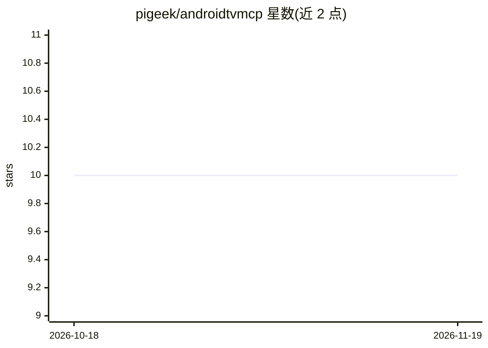

# pigeek/androidtvmcp

⭐ 10 · Python · MIT · 推送 2026-03-04 · [GitHub](https://github.com/pigeek/androidtvmcp) · 个人维护

**让 AI 助手通过 MCP 协议控制 Android TV 的服务器**

一个 Model Context Protocol (MCP) 服务器，将 Android TV 遥控能力桥接给 AI 助手等 MCP 客户端。提供设备自动发现、导航与播放控制、应用启动与切换、设备状态查询与电源控制等 10 余个 MCP 工具，并暴露设备信息、当前应用、播放与音量状态等资源。Python 编写，可从 PyPI 安装或源码部署，要求 Android TV 与服务器处于同一局域网。

## 筛选速览

| 维度 | 判定 | 备注 |
|---|---|---|
| AI 角色 | `ai-ecosystem` | LLM/agent 周边工具 |
| 许可风险 | `permissive` | MIT |
| 部署形态 | `library` | 以包/库形式分发 |
| 模型依赖 | — | README 未给出锁定关系 |
| 硬件要求 | — | 无带数字的原话,不猜 |
| 安装摩擦 | `low` | 无编译、无系统依赖或容器化 |
| 成熟度 | — | 结构信号不足 |

## 能力要点

- 自动发现局域网内 Android TV 设备
- 提供导航、播放、音量、电源等遥控 MCP 工具
- 应用管理：启动、列出、切换应用
- 暴露设备与状态类 MCP 资源（info/status/apps/playback 等）

## 适用场景

- 通过对话让 AI 助手代为操作电视导航与播放
- 在自动化工作流中集成 Android TV 控制
- 查询电视当前播放的应用与状态

## 场景标签

`GUI 自动化` · 领域:效率与自动化

## 证据(README 行号)

> L3: A Model Context Protocol (MCP) server that provides Android TV remote control functionality to AI assistants and oth
> L15: - **MCP Integration**: Standard MCP protocol compliance for easy integration

## 星数曲线

2026-10-18 10 → 2026-11-19 10（+0）

---
*卡片 v1 · prompt 1.4 · 生成 2026-11-19 · 置信度 high · 依据 README sha `36127d3fb470` · [字段定义](../../DATASET.md)*
