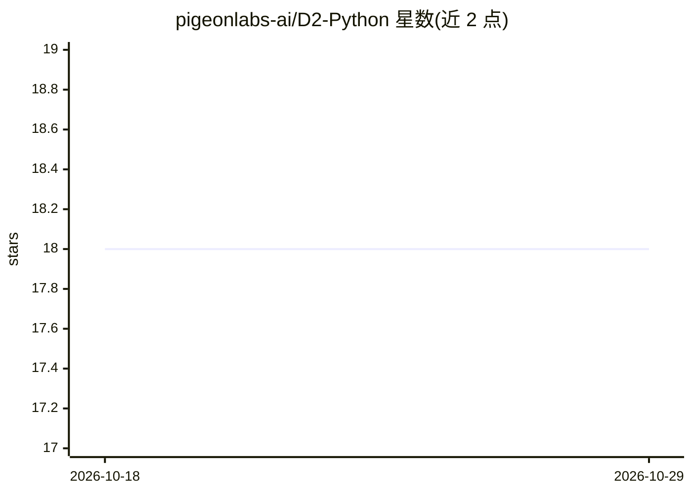

# pigeonlabs-ai/D2-Python

⭐ 18 · Python · NOASSERTION · 推送 2026-01-16 · [GitHub](https://github.com/pigeonlabs-ai/D2-Python) · 组织维护

**AI Agent 工具调用的函数级确定性防护 SDK**

Python SDK，通过 @d2_guard 装饰器在每次工具/函数执行前执行基于 YAML/JSON 策略的确定性检查：函数级 RBAC 权限、危险调用序列检测（N-hop）、输入参数校验（类型/正则/白名单等约 20 种约束操作符）与输出敏感字段过滤/脱敏。面向构建 AI Agent 应用的开发者，用于在 AI 控制执行流的场景下强制策略。无 D2_TOKEN 时读取本地策略文件，设置后从云端加载签名策略包；提供 ASGI 中间件、遥测与用户上下文管理。限制：输入校验仅支持顶层参数名，不支持嵌套点路径。

## 筛选速览

| 维度 | 判定 | 备注 |
|---|---|---|
| AI 角色 | `ai-ecosystem` | LLM/agent 周边工具 |
| 许可风险 | `none` | NOASSERTION |
| 部署形态 | `library` | 以包/库形式分发 |
| 模型依赖 | — | README 未给出锁定关系 |
| 硬件要求 | — | 无带数字的原话,不猜 |
| 安装摩擦 | `low` | 无编译、无系统依赖或容器化 |
| 成熟度 | — | 结构信号不足 |

## 能力要点

- 装饰器方式在每次工具调用前执行策略，默认拒绝未显式允许的工具
- 函数级 RBAC 与 N-hop 危险序列检测
- 约 20 种输入/输出约束操作符，输出支持嵌套点路径校验与脱敏
- 本地策略文件或云端签名策略包两种模式，策略在加载时校验

## 适用场景

- 我需要防止 AI Agent 被提示注入后执行危险的操作序列
- 为 Agent 的工具调用按角色做细粒度授权
- 在工具返回前自动脱敏或拦截敏感字段
- 校验 LLM 传给工具的参数是否符合规则

## 场景标签

`网络安全` · 领域:学习与行业

## 证据(README 行号)

> L107: D2-SDK adds granular control to any function your LLM or application can call. Think of it as a security guard tha
> L113: - Declarative guardrails. Set rules for arguments and return values in your policy file. D2 enforces them automati

## 星数曲线

2026-10-18 18 → 2026-10-29 18（+0）

---
*卡片 v1 · prompt 1.4 · 生成 2026-10-29 · 置信度 high · 依据 README sha `696411812994` · [字段定义](../../DATASET.md)*
